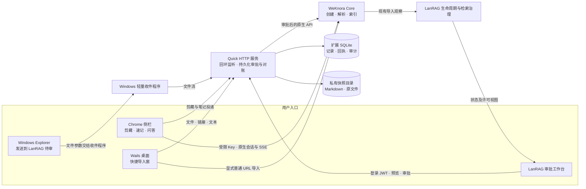
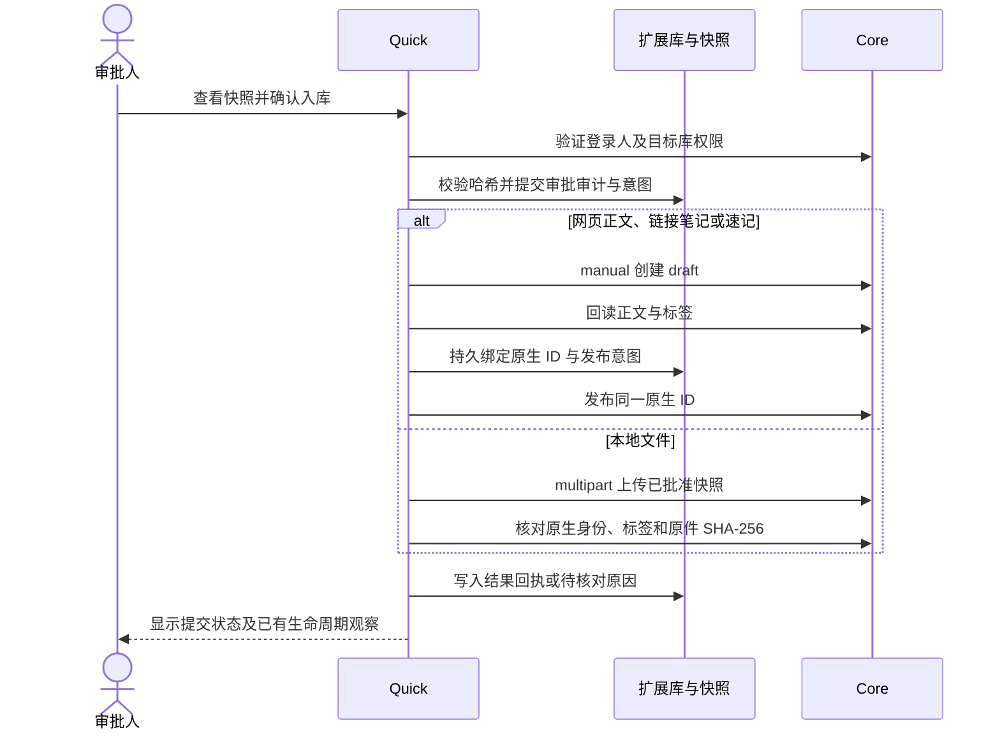
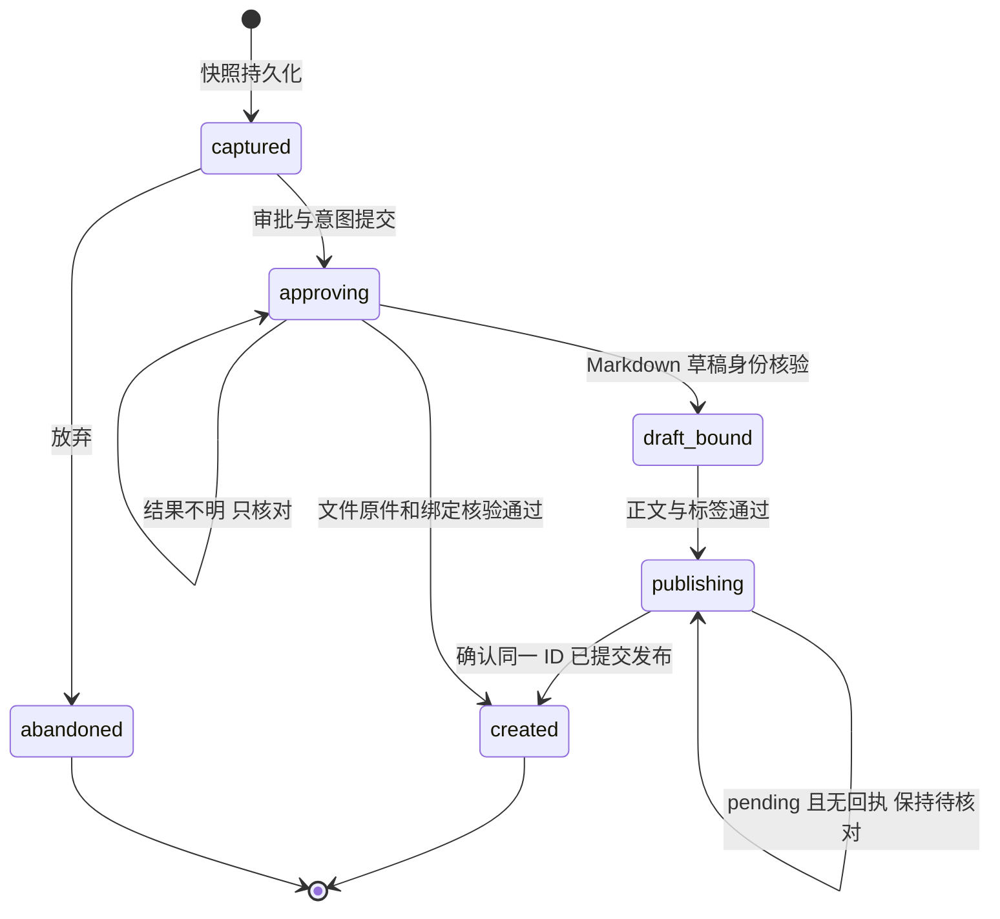
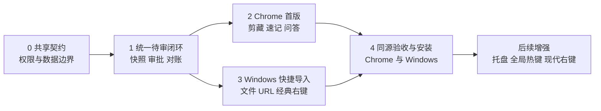

# LanRAG-Quick v1.3 外部线索采集与知识助手方案

> 2026-11-24 · 设计稿 · 适用 Chrome 与 Windows 上的 LanRAG Desktop
>
> 核对基线为 WeKnora v0.9.0（`f17ee8a`）及 LanRAG-Next `249d6dc2`。本稿为后续实现提供契约和验收标准。依据 [BASELINE.txt](../../BASELINE.txt)、[仓库规则](../../AGENTS.md) 与 [Frozen Architecture](<AgentRAG 技术方案 v1.0 — Frozen Architecture.md>)。
>
> [打开离线 UI 原型](<LanRAG-Quick v1.3 UI 原型.html>) · [v1.2 设计记录](<AgentRAG 外部线索快捷采集器与流转方案 (LanRAG-Quick v1.2).md>)

## 1. 产品范围和设计决策

LanRAG-Quick 把网页、个人笔记和本地文件收进同一个待审队列。Chrome 负责边看边剪、边记边问。Windows 负责从桌面、资源管理器和剪贴板快捷收件。LanRAG 工作台负责预览、审批和处理失败。文档通过审批后，使用原生 WeKnora 入库链路，解析、索引、问答和生命周期沿用当前系统。

| 工作面 | v1.3 设计范围 | 用户操作结果 |
|---|---|---|
| **Chrome 知识助手** | 同一个侧栏提供剪藏、Markdown 速记、知识库问答。右键划选可直接送审，打开侧栏可用 Chrome 快捷键。 | 剪藏与速记送到待审队列。独立的问答标签页提供选库、快速问答、追问、流式答案和引用。 |
| **Windows 快捷导入** | LanRAG Desktop 导入窗支持文件选择、拖放和粘贴 URL。资源管理器及桌面文件的经典右键菜单提供「发送到 → LanRAG 待审」。 | 文件生成原件快照，URL 默认保存为链接笔记。按条显示已收件、失败和重复状态。 |
| **统一审批台** | `/platform/clipper` 提供待审和历史列表、快照预览、目标库、标签、批准、放弃、查询处理结果。 | 成功送审、原生发布、解析完成与当前可检索分别显示。 |
| **Windows 增强入口** | 全局热键、托盘和 Windows 11 第一层右键菜单有明确接入路径，分批实现。 | 唤起同一个导入窗和待审队列，沿用同一套凭据和状态。 |

**三条使用路径各有明确含义。** 「送审」表示快照已进入 Quick。「确认入库」表示授权把当前快照提交到选定知识库。「从 URL 抓取」表示授权普通原生导入随后读取该网址。受控入库仅接受已审核的具体快照。原生 URL 抓取作为 Wails 中现有普通导入的显式入口，采用其独立语义与权限。

产品上参考 WeKnora 官方「知识管理助手」的剪藏、速记和问答能力，Quick 的名称、侧栏布局与实现独立。桌面优先扩展现有 Wails 壳。另开独立桌面后端会增加认证、运行和打包成本。Windows 右键验证通过后再建设现代菜单，避免首轮被 COM 安装和签名耽误。 [官方 Chrome 插件说明](../../website-docs/05-clients/06-chrome-extension.md) · [原生桌面说明](../../website-docs/05-clients/05-desktop.md)

## 2. 架构图与模块落位



| 组件 | 实施落点建议 | 职责 |
|---|---|---|
| Quick 服务 | `extensions/clipper/`，由既有 Host 生命周期管理组件启停，独立的回环监听和业务路由 | 收件、读取授权、审批事务、调用原生 HTTP、故障对账。 |
| 浏览器 | `extensions/ui/browser-extension/`，独立 Manifest V3 工程 | 用户触发剪藏、编辑速记、本地草稿、展示原生 SSE。直接连接配置的本机 Quick/Core 地址。 |
| Windows 快捷导入 | 现有 Wails WebView 中复用平台组件实现导入窗，新增非提权的 Windows 收件程序接 Explorer 文件参数 | 单次收件、有界流式读取和回执。进入已有桌面应用完成后续步骤。治理状态仍由 Quick 服务管理。 |
| 平台界面 | `frontend/src/views/clipper/` 与 `frontend/src/api/clipper.ts` | 待审、查看快照、承接登录状态、来源详情、原生详情跳转和恢复反馈。 |
| Core 与治理 | 继续使用公开 REST、现有生命周期观察与管理接口 | 保持现有出入库、索引、知识库权限和模型入口。新增 Quick 功能的状态和策略位于扩展模块。 |

Core 受控源码、原生表、根 `go.mod/go.sum`、四类 Bridge Hook 契约与 Frozen Architecture 保持冻结。新增 Windows 桌面接线只使用薄入口，实施时单独审查 Wails 外壳和安装器的最小差异。扩展沿用现有 HTTP client 并按需补通用流式 multipart。 [扩展模块约束](../../AGENTS.md#L13) · [Wails 启动和绑定](../../cmd/desktop/main.go#L455)

## 3. UI 与交互说明

[交互原型](<LanRAG-Quick v1.3 UI 原型.html>) 使用示例数据演示三种入口、状态文案与待审关联。生产平台业务页采用现有 TDesign 骨架和交互组件。以下线框描述信息位置，原型比例仅供评审。

```text
Chrome 侧栏（窄栏）                        Windows 快捷导入（Wails 小窗）
┌────────────────────────┐                ┌───────────────────────────────────┐
│ LanRAG Quick  打开待审 │                │ 快捷导入                查看待审 │
│ 剪藏    速记    问答   │                │ 文件  /  URL                      │
├────────────────────────┤                ├───────────────────────────────────┤
│ 剪藏方式  划选/正文/链接│                │ 拖入文件或选择文件                 │
│ 标题                  │                │ 报销说明.pdf        428 KB  待送审 │
│ 来源域名和快照预览     │                │ 补充规定.docx       62 KB  待送审  │
│                       │                │ 目标库  [ 示例资料库 ]             │
│               [送审]  │                │                     [送入待审]    │
└────────────────────────┘                └───────────────────────────────────┘

LanRAG 待审工作台
┌─────────────────────────────────────────────────────────────────────────────┐
│ 快捷采集                                      知识库 [示例资料库] [新建采集] │
│ 待审 处理中 历史          来源 [全部]              搜索标题                  │
├─────────────────────────────────┬───────────────────────────────────────────┤
│ 财务差旅公告     网页    待审    │ 财务差旅公告 · 快照预览                  │
│ 费用规定.pdf    文件    待核对  │ 来源 · 采集时间 · 文件大小 · 指纹       │
│ 工作备忘         速记    已生效  │ 预览正文或打开已冻结的文件副本           │
│                                 │ 目标库 · 标签 · 处理及生命周期状态       │
│                                 │                      [放弃] [确认入库]   │
└─────────────────────────────────┴───────────────────────────────────────────┘
```

| 界面 | 主动作 | 需要呈现的状态 |
|---|---|---|
| Chrome「剪藏」 | 右键选区直接送审，或从侧栏预览当前页正文、选区与链接条目 | 预览、正文提取失败、送审中、送审成功、服务离线。自动提取失败时可改划选或主动选择「仅保存链接」。切换网页时固定当前预览的来源。 |
| Chrome「速记」 | 编辑、预览、保存本机草稿、送审 | 本机草稿与已送审状态分开。送审后再编辑时以新快照送审，旧审批不适用于新正文。 |
| Chrome「问答」 | 选授权库、提问、追问、停止、打开引用 | 首包前、流式输出、完成、终止、断线、无授权库。切库建立新会话，上一库的问题和引用留在上一会话。 |
| Windows 导入窗 | 文件选择/拖放、粘贴 URL、选库、逐件提交 | 多文件独立记结果。显式提示「只保存链接」与「打开 Chrome 剪藏正文」的不同入口。失败项目保留在当前窗口供重新选择或重试。 |
| 待审工作台 | 筛选、预览、审核备注、确认入库、放弃、核对 | 待审、处理中、待核对、重复已存在、解析失败、已解析、按库规则生效。只在当前已获有效许可时显示「可检索」。 |

界面层用 `t-tabs`、`t-form`、`t-form-item`、`t-select`、`t-table`、`t-drawer`、`t-alert` 和 `t-tag`。复用 `.section-header__top`、`.section-description` 和语义 token。跨语言使用六语键、当前区域时间格式与可换行布局。键盘操作支持 Tab、取消以及清晰的焦点回归。停用、失败和对账仅显示对应主操作，未获得可核对结果时反馈「待核对」。 [平台 UI 规则](../../AGENTS.md#L86) · [上传确认组件](../../frontend/src/views/knowledge/components/UploadConfirmDialog.vue)

## 4. 客户端接入

### 4.1 Chrome

- 使用 `sidePanel` 以及 Chrome 扩展级快捷键。用户明确操作后读取当前选区或已加载页面的文章正文。用本地页面结构提取最小必要文本并生成可预览 Markdown。首轮支持普通文章与用户划选，复杂站点、图片归档和 AI 正文提取按扩展项处理。
- 「仅保存链接」生成包含标题与 HTTP(S) URL 的 Markdown 条目，界面标识链接笔记。标签页或 URL 变化后保留快照的实际来源。采集载荷只提交生成的 Markdown 和来源元数据。页面 HTML、网页 Cookies 和站点凭据不进入载荷。
- 速记编辑态留在受信任的扩展存储，送审时生成固定正文。来源 URL 为用户显式携带的可选字段。页面消息只传输捕获的数据，网络请求只从扩展上下文发往各自配置的固定端点。
- 快速问答先 `POST /api/v1/sessions`，随后 `POST /api/v1/knowledge-chat/{session_id}` 并携带显式选中的 `knowledge_base_ids`。使用原生 SSE 事件、停止和引用路径。请求仅含用户此轮明确输入，待审快照、速记草稿和当前网页正文不自动附加。
- 问答 Key 独立配置为受限 `chat` 加必要 `retrieve`，限定明确的库集合。Quick 界面和请求只走快速问答。原生 `chat` 能力也可能被用来访问原生 `agent-chat`，仍由 Core 执行自身权限检查。浏览器投递凭据与问答 Key 各自轮换。 [Chrome 侧栏](https://developer.chrome.com/docs/extensions/reference/api/sidePanel) · [扩展网络权限](https://developer.chrome.com/docs/extensions/develop/concepts/network-requests) · [原生会话和问答](../../internal/router/routes_chat.go#L150)

### 4.2 Windows 桌面与资源管理器

1. Wails 导入窗口先支持选文件、拖入文件和粘贴链接。通过已有桌面 API 地址获取配合登录态访问对应实例，沿用本机 Core/Host 和当前知识库。桌面和 WSL 的服务端口及数据目录各自配置，避免用固定默认端口误连另一个实例。 [桌面 API 地址与端口](../../cmd/desktop/app.go#L63) · [桌面与 WSL 运行证据](../../docs/evidence/desktop-full-verification-2026-11-22.md#L10)
2. 自用和试用版在当前用户的「发送到」菜单登记收件程序快捷方式，提供「LanRAG 待审」。双击桌面快捷方式可以打开导入窗；文件右键可传单选或多选。收件程序接收 Explorer 传入的路径参数，验证是用户显式选择的受支持文件，逐个读取并流式送给 Quick。路径不通过命令拼接或放入 URL。跳过目录并给出反馈。
3. 默认在配对时绑定实例、收件权限和目标库。已有桌面会话可经原生权限检查选择其他可写库。Quick 服务不可用时显示失败和打开 LanRAG 的入口，原件保留，当前动作可重试。注册和卸载仅处理当前用户安装项，验收确认其他菜单项保留。
4. 如发布范围要求 Windows 11 第一层菜单，使用 `IExplorerCommand` 配合 app identity。未打包的 Win32 应用可采用 sparse package。菜单回调只传文件给既有收件程序。进一步增加托盘和全局热键时，用 `RegisterHotKey` 唤起同一窗口，用户执行粘贴才读取剪贴板。 [资源管理器经典右键](https://support.microsoft.com/en-us/windows/experience/fileexplorer/file-explorer-in-windows) · [现代右键菜单接入](https://learn.microsoft.com/en-us/windows/apps/desktop/modernize/integrate-packaged-app-with-file-explorer) · [Windows 全局热键](https://learn.microsoft.com/en-us/windows/win32/api/winuser/nf-winuser-registerhotkey)

### 4.3 三种 URL 行为

| 模式 | 预览和审批对象 | 原生接入 |
|---|---|---|
| **仅保存链接**（桌面默认） | 标题和 URL 组成的链接笔记快照，对应审阅时的字节 | 审批后 `manual` 创建草稿、核验并发布 |
| **剪藏网页正文** | 浏览器里当前已加载文章正文或选区，带来源，预览对应明确快照 | 审批后 `manual`；打开 Chrome 剪藏给用户操作 |
| **普通 URL 导入**（已有原生导入） | 用户确认网址和目标库，Core 后续抓取页面。交互说明抓取结果取决于当时网页。 | 既有上传确认路径调用 `/knowledge/url`，作为普通入口使用，受 Core 库权限约束。Quick 不将该结果登记为已审核正文。 |

## 5. 审批、入库和恢复

### 5.1 不变量

1. **审批前零入库**。Quick 的任何剪藏、速记或文件收件在批准前都是本地快照，这些收件操作对目标库新增零文档、零解析任务。Core 原有导入入口仍由普通库权限约束。右键或热键的成功提示只表示已送审。
2. **批准绑定版本和身份**。核准实际审批人、租户、库、标题、来源、快照哈希、标签和记录修订号。变化需要重新预览和核准。审批审计、操作回执和原生写入意图同一扩展事务提交。
3. **提交不可用半成品替代**。文本签核绑定预览后的 UTF-8 Markdown。文件签核绑定私有快照的**原始字节**；审批后上传这份快照。解析文本与原件是不同产物。
4. **结果不明优先核对**。重复点击按同一次操作收敛，Core 的创建接口不是本地事务的一部分。网络中断、结果不明或校验冲突时先核对远端，快照保留。无法证明无副作用时禁止自动重发创建。



### 5.2 文本与文件各自的原生行为

| 分支 | 审批后的执行方式 | 必须处理的差异 |
|---|---|---|
| **Markdown** | `POST /api/v1/knowledge-bases/{kb}/knowledge/manual` 带 `draft`、标签和稳定采集标识。绑定 ID，发布前再次回读正文、标签和当前草稿状态，再 `PUT /api/v1/knowledge/manual/{id}` 发布同一正文。当前原生接口没有跨客户端的正文、标签和状态联合 CAS，并行编辑时报告冲突。 | 原生创建及更新会 `CleanMarkdown`。审批正文与草稿回读不一致时，停止发布并显示差异。来源 URL 写在 Quick 来源记录。 |
| **文件** | `POST /api/v1/knowledge-bases/{kb}/knowledge/file`，原样读取快照流，提交 `file`、显式标签 ID 和对账标识。绑定原生 ID 后回读标签，必要时下载原件计算 SHA-256。 | 原生文件入口一次创建并安排解析，当前无 Markdown 式草稿发布两步。必需标签预检失败不上传。上传后回读用于核验与对账，Core 可能在回读前已开始解析。要求二次核验前始终禁止生效的库，首批暂不接文件快导，需独立设计生效门禁。 |

文件上传按原生支持格式预检。可接收上限取 Core 当前上传上限与 Quick 可完整回读核验上限的较小值。当前复用的 `OriginalSHA256` helper 上限为 50 MiB。若目标库允许更大的文件，先把原件流式核验调整为同等有效上限并验证，再扩大 Quick 接收范围。批次按文件独立接收、审批与对账。Core `file_hash` 用 MD5 查重，Quick 单独保存 SHA-256 用于原件核验。返回已有重复文档时显示「已存在」并核对 ID 和作用域；既有文档不自动被认领为本次上传，也不改写其标签。Core 在写入文档后设置标签。标签写入失败可能留下已落库、尚未入队的原生记录。须核对同一文档的作用域和原件指纹，经授权修复并回读确认必需标签后，才允许使用原生同文档重试。 [文件与手工入库 API](../../website-docs/04-api/02-api-knowledge.md#L329) · [原生 MD5](../../internal/application/service/knowledge_util.go#L130) · [文件创建与标签顺序](../../internal/application/service/knowledge_create.go#L216) · [回读原件 SHA-256](../../extensions/weknora/original.go#L42)

### 5.3 状态与用户反馈



- **对账**。已有目标 ID 优先精确回读。文本和文件创建都把持久化的不可预测操作 UUID 写入原生请求的 `channel`（`quick:<operation_uuid>`）；具体采集方式保存在扩展记录中。该值是远端对账标识。创建响应丢失时，按作用域、有界原生分页和该标识查找。候选再次核对租户、库、类型、原内容/文件哈希和必需标签。只有同一标识与内容唯一匹配时才认领。正文字段缺失、多个候选、不完整分页和零匹配但结果未知均显示「待核对」。仅有可确认请求未发出或在写入前被拒绝的证据时，才允许有权限的用户在同一意图上重试。 [现有发布对账样例](../../extensions/business/native.go#L111)
- **发布与解析**。`created` 表示原生入库动作已核验，不表示解析或生效。Markdown 发布超时只回读同一文档及已有解析观察。远端只有 `pending` 且缺成功回执时保留 `publishing`。确认异常与目标文档、快照及必需标签一致后，优先沿用原生同文档重试，禁止重新创建第二份文档。
- **生效**。本版保留一次准入审批。解析完成后由现有观察者按库规则和依赖推进。待核对、已解析和可检索为三种含义；UI 只按实际有效许可展示可检索。默认一分钟是观察间隔，无记录时显示等待。 [观察和状态推进](../../extensions/ingest/lifecycle.go#L24) · [检索许可](../../extensions/retrieval/policy.go#L266)

## 6. Quick 接口、数据与权限

下表为拟新增的 Quick 接口。实现前按宿主惯例核对最终命名，共用统一响应与稳定错误码。Quick 走独立地址，原生 Core URI 保持原有契约。

| 方法与路径 | 调用者与请求 | 响应和副作用 |
|---|---|---|
| `POST /quick/v1/captures` | 受限投递凭据或已授权的桌面登录上下文。JSON 包含 `source_kind`、标题、内容和可选 `source_url`；文件使用 multipart。每件自带 `capture_request_id`。 | `201` 返回 `clip_id`、`captured`。凭据和收件 ID 相同的重试返回同一回执。快照或持久化失败时返回失败。一个文件一份回执。 |
| `GET /quick/v1/captures` | 工作台登录 JWT；必选当前作用域，按状态、来源和标题分页 | 返回最小列表元数据，服务端校验作用域和库权限。 |
| `GET /quick/v1/captures/{clip_id}` 和 `GET .../{clip_id}/preview` | 有目标库审核权限的当前用户 | 返回版本、状态、指纹及只读预览。需要打开原件时只提供已冻结副本，回读不触发正文抓取。 |
| `POST /quick/v1/captures/{clip_id}/approve` | 审批 JWT；`operation_id`、`expected_revision`、已预览的哈希和目标库 | 仅在本地审批与意图持久化后确认受理。本次 JWT 有效且仍有授权时，在当前请求内推进原生操作。已确认完成时返回结果。尚需核对或续办时返回 `202` 和当前阶段。版本、正文或权限有冲突时拒绝继续写入。 |
| `POST /quick/v1/captures/{clip_id}/abandon` | 当前有权限的用户；记录修订号和说明 | 从待审放弃，后续按保留策略清理。已有外部写入意图的记录转核对。 |
| `POST /quick/v1/captures/{clip_id}/reconcile` | 当前有权限的用户，或已有只读后台核对器 | 刷新原生观察和对账证据，只读核对远端。 |
| `POST /quick/v1/captures/{clip_id}/resume` | 有权限的登录用户；原 `operation_id` 与当前记录修订号 | 从已证明的阶段续办。核验当前 JWT、同一意图及快照。一旦写入结果未知，只允许对账。 |

网页正文、选区和网页链接按来源要求绑定 `gov:source:web`。外部内容按库要求绑定 `gov:doctype:external`。个人原创笔记保留速记类型。审批时按实际目标库查询最新的原生标签 ID，缺少必需标签时拒绝发起原生创建。入库后用精确标签读取接口回查。 [原生标签读取](../../internal/handler/knowledge.go#L683)

稳定错误码建议包含 `snapshot_changed`、`unsupported_media`、`upload_limit`、`kb_forbidden`、`required_tag_missing`、`stale_revision`、`duplicate_native_document`、`outcome_unknown` 和 `remote_unavailable`。前端按错误码映射六语提示。包含源 URL、原件路径和原生错误详情的诊断仅用于当前有权限的上下文。

扩展库保存 `clip_id`、来源类别和方式、租户、库、标题、可选 URL、快照相对路径、SHA-256、大小、状态、修订号、审批人、操作 ID、原生关联标识和文档 ID。收件回执绑定投递主体和内容，同一操作不能携带两套不同快照。文档 ID 的绑定限定租户和库，按实际最新迁移号追加。在私有目录临时写入、同步、原子改名，再持久化记录；回执前完成二者。清理失联且超过保留期的临时文件时核对记录。待审、待核对和仍需核验的快照持续保留。原件与日志保持本机最小权限，目录避开 Agent 工作区。 [副本治理](M2-Copy-Lineage-2026-11-01.md)

| 凭据 | 可达范围 | 界面 |
|---|---|---|
| **Quick 投递凭据** | 固定实例和收件作用域。仅新增待审快照。Chrome 使用固定扩展 Origin，Windows 收件程序使用独立的受限配对凭据。 | 侧栏剪藏与速记、Explorer 收件程序 |
| **WeKnora 登录 JWT** | 当前用户的审批和原生写权限。Quick 先用 `/auth/me` 与 `/lifecycle/authority` 核对身份和目标库，后续原生入口再鉴权。仅本次请求转发。 | Wails 登录窗口和 LanRAG 审批台 |
| **WeKnora 受限问答 Key** | 明确知识库白名单及 `chat/retrieve`，Core 校验查询和会话权限。 | 浏览器问答 |
| **Host 只读凭据** | 读取目标文档、必要时读取已授权原件和对账观察。 | 服务端恢复 |

凭据只发送到绑定实例与对应接口，日志不输出凭据、正文或完整来源参数。Quick 回环监听和 Origin 检查用于本地接入限制，服务端同时核验调用凭据。Windows 不转交桌面免登录启动凭据。审批服务遇到权限撤销、实例变化或 JWT 过期时等待当前身份重新授权。 [原生鉴权](../../website-docs/04-api/01-api-overview.md#L33) · [库权限入口](../../internal/router/routes_knowledge.go#L235)

## 7. 资产复用清单

| 资产 | 决策 | 复用内容和限制 |
|---|---|---|
| WeKnora REST 与 Core | **KEEP** | 文件、URL、Markdown、标签、详情、原件、会话与 SSE。Quick 增加采集与准入流程。 |
| Wails 桌面壳与安装器 | **KEEP / ADAPT** | 复用运行实例、WebView 与原生入口，补导入窗和 Windows 快捷收件；不建立第二套 Core 或数据库。 [桌面壳](../../website-docs/05-clients/05-desktop.md#L18) |
| Vue/TDesign 与导入 UI | **KEEP / ADAPT** | 参照 `KbUploadSourceDropdown`、`UploadConfirmDialog`、生命周期页面骨架和六语词条。Quick 的提交调用转向暂存，并保持核心上传流程的既有调用。 [上传入口](../../frontend/src/views/knowledge/components/KbUploadSourceDropdown.vue) |
| LanRAG 扩展发布、标签、观察 | **ADAPT** | 借用先留意图、稳定标识、完整分页、原件读取、显式标签 ID 与生命周期观察。现有修订提案、附件归属、问答反馈、关键血缘保留原业务语义。 [扩展发布](../../extensions/business/native.go#L111) · [附件上传参考](../../extensions/weknora/attachment.go#L76) |
| 官方 Go SDK / CLI | **REFERENCE / 测试资产** | SDK 用于核对 multipart、URL 和 SSE 契约。CLI 的 `doc upload`、`doc fetch`、`doc create` 可做隔离库联调。扩展门禁拦截 WeKnora 模块前缀，首版沿用已有 HTTP client。 [SDK](../../website-docs/05-clients/03-go-sdk.md#L96) · [CLI 入口](../../cli/CHANGELOG.md#L167) · [模块门禁](../../extensions/scripts/check_module_boundary.py#L26) |
| 官方「知识管理助手」与 BrowserSkill | **REFERENCE** | 前者参考产品能力。后者参照本仓锁定的 v0.3.1 的扩展构建、UI/后台入口和消息处理；Quick 的命令由用户主动触发，无 BrowserSkill daemon、配对或浏览器控制依赖。 [BrowserSkill 锁定](../../scripts/browserskill-release.json) · [扩展工程](https://github.com/Tencent/BrowserSkill/tree/da6bf4eed2dd7256567e152df8c903c87f6598c3/apps/extension) · [许可证](https://github.com/Tencent/BrowserSkill/blob/da6bf4eed2dd7256567e152df8c903c87f6598c3/LICENSE) |
| 原生 MCP、解析器或 Agent 扩展点 | **LATER** | 将来需要从其它客户端问答时复用受限内置 MCP。桌面收件用 HTTP。新增解析、检索和 Agent 核心插件超出首版入口交付。 [内置 MCP](../../website-docs/03-features/08-mcp.md) · [原生扩展点](../../website-docs/06-development/03-extension-points.md) |

## 8. 交付顺序与验收

下列是同一版设计的实施顺序。阶段以可核验的出口条件推进，具体工期在确认实际平台、安装方式和可用测试环境后估算。



| 阶段 | 交付 | 出口条件 |
|---|---|---|
| **0 · 接口与身份定案** | Quick 回环服务端口发现、配对范围、错误码、独立 SQLite 迁移及工作台蓝图 | 验证 JWT/Key/投递凭据分离，确认 Wails 与浏览器指向同一工作实例，同时核对 BrowserSkill 参考版本与 Quick 发布 ID。 |
| **1 · 共用队列** | 粘贴和链接笔记 → 审批 → Markdown 草稿 → 原生发布 → 观察 | 用隔离知识库验证审批前零文档零解析任务，篡改后拒绝，重复点击和未知结果按同一原生 ID 核对。 |
| **2 · Chrome 首版** | 剪藏、速记、问答同一版本；Chrome 支持的侧栏和快捷键 | 实装 Chrome 验证选区/文章/链接、草稿恢复、问答流/引用、授权失效、跨库拒绝和切换标签页行为。 |
| **3 · Windows 快捷导入** | Wails 选文件/拖放/贴 URL，经典右键；单件与批量回执 | Explorer 的真实桌面与资源管理器、Wails 正常和未启动、中文及空格路径、单/多文件、原件变化和未知结果。验证卸载后本安装的右键项移除。 |
| **4 · 同源验收** | 可安装的 Chrome 扩展、对应 Windows 桌面构建与平台产物、问题与回退记录 | 在独立测试库跑完端到端与故障用例，桌面/浏览器同源产物验收，保留执行命令、退出码、构建来源与待验证项。 |

### 8.1 核心验收矩阵

| 编号 | 场景与关键判据 |
|---|---|
| A01 | 网页选区、正文、仅链接、速记、手动粘贴、本地文件均能生成待审项。按提交前基线核对原生清单和队列，确认审批前这些收件对应的新增文档和解析任务均为零。 |
| A02 | Markdown 草稿回读匹配批准快照才发布；文件只上传批准副本，并核对原件 SHA-256。修改原路径、篡改快照和超限均有明确处理。 |
| A03 | 投递或问答凭据无法执行审批和原生文档写入。库范围、会话归属、普通只读账号、撤销权限和跨实例切换均做负向验证。 |
| A04 | 断在本地事务前、Core 创建后失去响应、标签写入失败、发布保存后入队前、以及应用重启等位置，分别核对 DB、文档数和任务数。确认未知结果不自动重发。 |
| A05 | 解析结果与当前 active 许可独立展示。对有效文档验证正向问答与引用；对待审、未生效、失效文档验证无受控来源。 |
| A06 | 真实 Windows 右键、拖放和选择文件。批量混合成功/失败逐条显示；选中文件夹时按已公布边界提示。只在用户点击后读取当前选择与剪贴板。 |
| A07 | URL 三种入口语义清楚。链接笔记保留来源，已审网页正文不触发重新抓取。普通 URL 导入使用原生抓取并走原有鉴权。 |
| A08 | 中文和英文完成侧栏、导入与待审主流程，韩日俄繁词条检查键集。焦点、空态、错误与安全预览可操作。 |

实施时启用扩展 `gofmt -l .`、独立模块门禁、`go build -mod=readonly ./...`、`go test -mod=readonly ./... -count=1`、`go vet -mod=readonly ./...`。前端按仓库规定运行 `npm run check-i18n`、`npm run type-check`、`npm test`、`npm run build` 并核对真实构建产物。受控区差异用 `git diff -- internal/` 审查。本稿的图和原型用于设计验证，真实入库、Windows 安装及生产行为由实施验收证明。

## 9. 后续功能与启用条件

| 延伸 | 何时推进 | 复用方向 |
|---|---|---|
| 系统热键、托盘、Windows 11 第一层菜单 | 经典入口、重启与卸载先通过，收件动作稳定 | 复用同一导入窗、配对与队列；系统层只负责唤醒和路径传递。 |
| 更完整的网页归档、图片和 AI 正文提取 | 明确原件、派生文本和授权展示的身份关系后 | 复用原生文件存储和解析。网页抓取用于生成待审快照时，另行设计允许的网络目的地与提取证据。 |
| 批量目录、历史收藏与外部数据源 | 按批范围、去重、失败重跑与回执可验证后 | 批次复用单条收件和核验。自动同步沿用既有数据源思路，审批策略单独批准。 |
| 侧栏智能推理和显式「就本页提问」 | 当前网页作为允许的显式上下文，来源关系与撤销行为有验证后 | 复用 `agent-chat`、原生来源门禁和引用。 |
| 跨设备入口与第三方助手 | 部署与身份边界明确后 | 问答优先复用受限 MCP；送审继续用 Quick 的最小权限契约。 |
| 规范性关系、替代与受控发布 | 需求需先明确依赖、审计与前后版本 | 在 LanRAG 现有 `supplements`、版本族和修订发布工作台处理，Quick 保留来源与文档关联。 |

文档内需复核的实现前决策是 Windows 安装形态、可接受的原件预览范围、单文件与批量限额、快照保留期，以及纳入文件快导的治理库清单。原生接口行为和既有工作台入口须在实现所用提交上再次核对。
