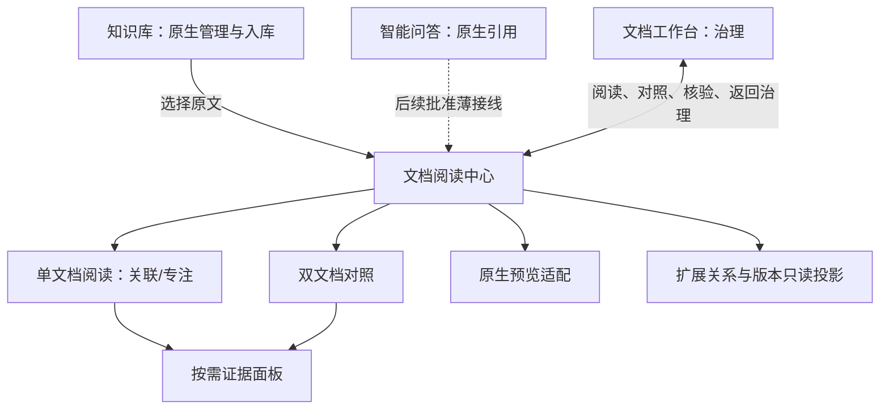
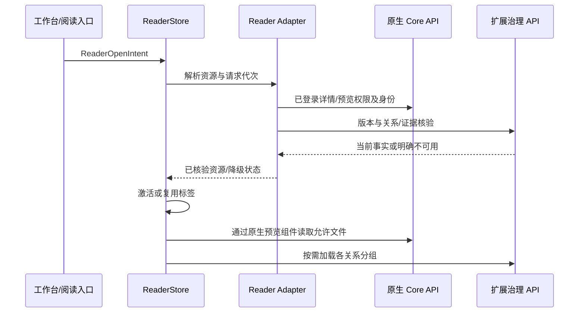

# LanRAG-Next 文档阅读中心与关联研读系统

**Document Studio · 产品与技术改造最终方案 v1.1 — 原生复用与体验优先**

| 项目 | 内容 |
| --- | --- |
| 文档状态 | 实施中设计稿（P1 隔离浏览器验收完成；Windows Lite 桌面已部署并完成真实 DOCX 与附件面板验收；不构成核心改动授权） |
| 日期 | 2026-11-24 |
| 项目 | LanRAG-Next / LanRAG Lite（基于 WeKnora Lite） |
| 审查分支 | `codex/m1-parser-routing` |
| 实现提交 | `d6057e41`（`batch6-1-gd6057e41`；阅读中心源码仍在工作区，未提交） |
| 冻结上游基线 | `Tencent/WeKnora` v0.9.0，`f17ee8a`（已核对 `BASELINE.txt`） |
| 架构约束 | Frozen Architecture、Core + Extension Host、Bridge v1、`AGENTS.md`、`PATCHES.md` |
| 建设方式 | 独立自研阅读中心 + 双文档对照 + 工作台联动 + 原生能力复用 |
| 建议任务编号 | `DOC-STUDIO`（与原 M6 展示任务衔接，编号待维护者确认） |
| 建议归档位置 | `docs/design/文档阅读中心与关联研读系统-v1.1.md` |

> 本方案基于已读取的项目文档、当前分支相关源码和 WeKnora v0.9.0 原生预览实现进行静态设计。v1.1 定稿时尚未运行项目、修改代码、执行迁移或部署。截至 2026-11-24，工作区已按本方案完成 P1 主干与 P2/P3 部分实现，阅读中心 P1 已在隔离浏览器夹具中通过；实际源码映射、预览与权限矩阵、双实例验证见 [document-studio-source-mapping-2026-11-24](../evidence/document-studio-source-mapping-2026-11-24.md)。Windows Lite 安装版前端已切换至最终构建（2026-11-25 00:30，入口 SHA-256 `5f86d3c11d00e6151b672e2d55cd187e2008f3e648baf9f2bd1d709d38a143b5`），已用真实测试库完成 DOCX 单窗预览与附件面板验收；PDF／XLSX／图片格式矩阵、真实权限负向与既有业务链路仍待补测。本文不修改冻结架构，不自动授权核心受控区改动。

## 0. 执行摘要与核心裁决

### 0.1 建设目标与版本变更

本版是 v1.0 的完整替代设计稿，不是新增功能清单。核心目标是提升用户阅读体验、优化知识库/问答/工作台之间的衔接，最大限度复用 WeKnora 原生与 LanRAG-Next 已有扩展能力。采用用户确认的 C+D（独立阅读中心 + 双文档对照）路线。排期采用**先整体框架、后功能细节、最后退役旧图**，每批交付可运行、可体验的纵向闭环，不先堆叠抽象层或追求所有格式和关联分类完美。

主要变化：原生灰白底色与绿色品牌色明确纠正；完整落实最新 AGENTS.md §8；增加动态图标、原生布局与无障碍规范；四种阅读布局收敛为单文档/双文档两个工作状态，专注与证据是面板配置，不是新页面；工作台联动提前进入第一批；旧图替代验收之后才下线。差异算法、个人笔记、时态研究、自动关联、研读助手、插件系统均不纳入本专项开发范围。

### 0.2 设计裁决

| ID | 决策 | 实施约束 |
| --- | --- | --- |
| DS-D01 | 独立阅读中心，融合 C+D | 原生知识库、问答和自研工作台职责不变；不复制文件管理 |
| DS-D02 | 分类折叠列表替代节点图 | 底层 Lineage、关键边、循环保护、历史查询、MCP 和原生 GraphRAG 保留 |
| DS-D03 | 原生预览原样复用 | 只使用经核验的契约；禁止复制渲染器、DOM hack、重写原生预览 |
| DS-D04 | 双文档对照进入整体骨架 | 先左右独立真实预览，后拖拽/位置恢复等细节；同步滚动按能力验证 |
| DS-D05 | 工作台是治理主入口 | 阅读中心只读、定位、对照和导航；编辑、审核、发布、删除仍由工作台处理 |
| DS-D06 | 阅读视图是只读投影 | 无新关系表、生命周期状态机或文件事实源 |
| DS-D07 | 版本身份优先 | 不按文档 ID 冒充历史原件；原件不可核验就明确降级 |
| DS-D08 | 阅读与 RAG 权限严格分离 | 不扩大历史阅读或模型证据资格；保留已有门禁 |
| DS-D09 | 原生最小侵入 | 首期目标 internal/ 零新增改动；路由、菜单、六语接线记入 PATCHES |
| DS-D10 | 先替代后退役 | 新导航覆盖旧图语义与入口，验收后单独清理 UI 和专属依赖 |
| DS-D11 | 不新增关系语义 | cites 不等于制定依据；当前不能区分就合并为引用；新增枚举另议 |
| DS-D12 | 不改变部署模式 | Core/Host 独立构建；无新模型、数据库、服务和知识库 |
| DS-D13 | 继承原生视觉与交互 | AGENTS §8 优先，使用 TDesign、语义 token、六语、现有布局与拖拽组件 |
| DS-D14 | 骨架先行 | P0 做必要风险验证；P1 完成端到端真实最小闭环；P2 补全功能衔接；P3 打磨体验及退役 |
| DS-D15 | 不为未来功能过度设计 | 一个适配层、一个阅读 store、少量公共组件；不建动态插件、命令平台、微前端 |

### 0.3 首批用户可见成果

从原生菜单进入阅读中心，选择真实文件并打开原生预览；从工作台同样可打开原文，查看已有有效关系并将关联文件送入右侧窗格；左右分别核验权限和文档身份；返回工作台恢复原来的筛选、分页、选中项。首批暂不支持的能力应隐藏或显示有依据的不可用提示，禁止使用模拟数据、空壳按钮或虚假成功状态作为阶段验收。

## 1. 项目基线与源码审查

### 1.1 当前系统分工

- WeKnora Core：原生登录、授权、知识库、文件读取、解析/分块、检索、RAG、Agent、MCP 及 Web UI。
- Extension Host：生命周期事实、版本与血缘、业务关系、反馈、审核勘误、修订、附件及治理审计。扩展独立 Go module，独立 SQLite 持久层；依照既有回环 HTTP 边界运行。
- 文档工作台：`/platform/documents`，聚合文档台账、待复核、库级规则、附件、业务族、关联、反馈资料、修订和治理历史。单文档详情是治理抽屉，不是完整原文阅读器。
- 当前用户主要采用单用户单知识库场景，但系统接口已有知识库与租户作用域。不得以单用户为理由删掉已有授权和跨库校验。

### 1.2 原生功能复用矩阵

说明：✅ 直接复用；△ 通过适配或专项验证；＋ 新增自研功能。状态反映静态源码能力，不等于部署已上线。

| 能力 | 当前实现/入口 | 策略 | 注意事项 |
| --- | --- | --- | --- |
| 应用壳、导航、鉴权 | 原生 router、menu store、auth store | ✅ | 挂入原生 `/platform` 布局，复用登录和初始化守卫 |
| 知识库目录与文件搜索 | `KnowledgeBase.vue`、原生列表/详情接口 | ✅ | 阅读中心只做打开文档，不复制目录树管理、上传、移动、标签编辑 |
| 文档深链接 | `?knowledge_id=` 自动打开原生详情 | ✅ | 原生知识库跳转能力保留；阅读中心独立契约不替换旧 URL |
| 原文预览 | `components/document-preview.vue` | ✅ | 按原生支持格式展示，未知格式安全降级 |
| PDF 来源定位 | `components/source-preview/PdfSourceViewer.vue` | ✅ | `sourceMode` + `locate`；按需渲染、任务取消、每实例已渲染页上限 12 |
| Office、Markdown 等渲染 | 原生 DocumentPreview 与相关工具 | ✅ | 不新引入预览库；格式能力按当前版本实测矩阵确定 |
| 引用定位 | `utils/sourceLocator.ts`、`sourceLocatorDom.ts`、`ChatReferenceSourceView.vue` | △ | 复用定位结构、状态语义；不假定所有文件都有高精度 locator |
| 原生分块 | `doc-content.vue`、原生知识库 API | ✅ | 用于解析视图和证据辅助；不改原生分块算法 |
| 文件详情与批量标题 | `getKnowledgeDetails`、`batchQueryKnowledge`、`documentTitles` | ✅ | 按租户/库分组批量查询，避免逐文件请求 |
| 原文预览 API | `GET /api/v1/knowledge/{id}/preview` | ✅ | 只按文档 ID 读取，无历史 version 参数；Viewer 权限及附件门卫 |
| 原件下载 API | 原生下载接口 | ✅ | Editor 等有效权限，不能把预览 Blob 当下载授权 |
| 原生引用抽屉 | `ChatReferenceSourceView.vue` 等 | △ | 首期保持原有功能；后续最小接线打开阅读中心 |
| TDesign 与主题 | `tdesign-vue-next`、原生 CSS tokens、i18n | ✅ | 按 `AGENTS.md` 使用原生组件、灰白/深色背景与绿色品牌语义 token、语言包、键盘及焦点规范 |
| 多标签与双栏研读 | 无完整阅读中心 | ＋ | 自研状态、布局与资源调度 |
| 版本精确原件获取 | 尚未确认有完整版本寻址接口 | △ | P0 核验，不能伪造历史原文；缺失则只读元数据 |
| 条款自动差异 | 未审查到可直接复用的完整制度比对引擎 | ＋ | 后续增量；首期并排原文即可使用 |

### 1.3 扩展与工作台复用矩阵

| 能力 | 现有代码/API | 首期处理 |
| --- | --- | --- |
| 生命周期详情 | `api/lifecycle.ts` 的 `documentDetail` | 复用，显示有效性、时间、降级状态 |
| 当前有效关联 | `api/business.ts` 的 `related`；`extensions/business/related.go` 的 `QueryRelated` | 复用，保留双端版本核验、当前许可和方向 |
| 关系登记/历史 | `relationRecords`、`documentRecords`、`BusinessView.vue` | 复用；治理信息仅按权限展示，不混入有效关系 |
| 阅读说明与提示 | `ReadingRelationPreview.vue` | 复用其关系再核验 + 原生详情 + DocumentPreview 组合模式 |
| 补充通知 | `SupplementEditor`、`supplements`、当前依赖查询 | 复用依赖事实和双向语义，避免重复登记 |
| 业务版本族 | `api/families.ts`、`FamilyWorkspaceView.vue` | 复用族成员、发布头与可用性 |
| 正式替代历史 | `replacementHistory`、`replacements` | 复用正式替代链和生效日期，不以标题年份推断版本 |
| 观测版本/内容溯源 | `api/lineage.ts`、`extensions/lineage/{graph,query}.go` | 复用有边界的只读查询；不复用图形渲染作为事实源 |
| 条款证据 | `ClauseEvidence.vue`、`clauseEvidence`、`ClauseAnchor` | 复用 chunk ID + hash 核验；补强锁定版本与 locator 联动 |
| 附件治理 | `api/attachmentWorkbench.ts`、`AttachmentWorkbench.vue`、已有下载接口 | 复用主件版本、附件归属、序号、名称映射、原文位置、状态与引用摘录 |
| 审核勘误 | `correctionDocuments`、`correctionDocument`、`correctionMarkdown`、`verifyCorrectionRevision` | 按文档/版本展示已生效勘误，历史审核材料按权限 |
| 修订与拆分发布 | 现有 revision/split 工作台与服务 | 只增加读稿及对照入口，保持原发布门卫、事务和 Saga |
| 关联候选 | 业务族建议、关系候选 | 复用工作台审核；不让未确认候选成为有效关联 |
| 检索关系消费 | `query_related_docs` MCP | 保留原有行为；阅读中心不直接调用模型工具来替代管理 API |
| 清理与保留 | 清理队列、可用性观察、30 天保留规则 | 显示可用性，不恢复已删原件，不改变清理规则 |

### 1.4 本次静态审查的关键发现

1. `ReadingRelationPreview.vue` 已有不修改原生预览组件即可在自研工作台预览相关文件的实现先例：重新查询关系、检查目标和方向、获取原生详情并核验库归属，再渲染文件。阅读中心可将此模式扩展为公共适配层。
2. WeKnora v0.9.0 的原生预览已支持 `sourceBlob`、`knowledgeId`、`active`、`fillHeight`、`toolbarTarget`、`sourceMode`、`locate` 和 `located`。当前 fork 还存在 `disableAutoFocus`。不能假定该 fork 特有字段是稳定上游契约。
3. 当前 `/preview` 按 ID 返回文件，不能仅凭扩展 `version_node_id` 读取历史文件。业务族历史文件若以独立 ID 保存，才可能直接复用原生接口；同 ID 旧观测版本须核验是否存在可寻址的旧字节。
4. `QueryRelated` 是当前有效关系读取，非通用历史关系库；候选超过 100 条时返回 `ErrConflict`。`RelatedDocument` 前端类型也未提供完整版本固定字段。不能在前端把该响应包装为精确历史版本证据。
5. 原生预览端点按 Viewer 权限读取，下载要求 Editor 等授权；受管附件预览和下载均调用 `GuardAttachmentDownload`。普通原文管理读取与 RAG 的 active 许可不是同一规则，不能混为一谈。
6. `lineage_graph` 有显式截断和标题不可用标志，包含多个语义视图。可复用其查询结果用于历史展示，不得以整个图快照的节点数冒充准确关联总数，不得依据观测 `current` 判断正式发布头。
7. 当前原生 `document-preview.vue` 有全屏事件、焦点管理、Teleport、Blob 生命周期；双实例兼容需实际验证，不能凭单实例成功认定双栏可用。
8. `TASK_BACKLOG.md` 中问答硬化及勘误等存在隔离验收与生产部署状态区别。阅读中心应依据实际运行版本探测能力，不将仓库中已实现的接口默认视为全部已部署。

## 2. 产品定位及信息架构

### 2.1 四个模块职责

| 模块 | 定位 | 保留/新增 |
| --- | --- | --- |
| 智能问答 | 获取知识、引用证据 | 保留原生 RAG/Agent；按审批增加阅读中心深链接 |
| 知识库 | 文件入库、解析、分块和资源管理 | 保留原生页面与能力 |
| 文档阅读中心 | 阅读、研究、关联探索、并排对照、证据核验 | 新增独立入口 |
| 文档工作台 | 管理生命周期、版本、关系、审核、附件和发布 | 保留既有自研治理入口，新增阅读联动 |

阅读中心不提供上传、批量删除、关系审批、生效日期编辑、修订正式发布等完整治理表单。原有工作台不被替代，也不转成阅读器；仅复用阅读能力进行轻量证据预览。

### 2.2 路由与入口（拟定）

- 主入口：`/platform/reader`（路由名 `document-reader`，实施时检查名称冲突）。
- 菜单建议顺序：智能问答 → 知识库 → 文档阅读中心 → 文档工作台；保留其他现有导航。
- 工作台现有 `/platform/documents` 路由保持不变。
- 独立阅读中心可通过原生知识库选择器、授权文档搜索打开文件；空白页面提供「选择文档」「返回知识库」「恢复已有阅读状态（实现后）」，无重复上传入口。
- 工作台的文档管理点击语义不变：标题仍打开治理详情；按场景提供一个主操作「阅读原文」，对照/核验收纳到现有行操作或详情菜单；不在每行铺设多个入口。
- 默认不改变原生知识库文档详情与引用抽屉行为；可选原生入口薄接线放在后期单独审批。

### 2.3 产品导航结构



## 3. UI/UX 详细设计

### 3.1 整体布局：原生应用骨架 + 可复用阅读工作区

严格遵循用户上传的 `AGENTS.md` §8.1–8.5（含 2026-11-23 六语规范）。该文件要求以原生 TDesign 为唯一标准，不能把设计示意图中的色值、裸 HTML 控件或任意页头作为实现依据。

```text
┌──────────┬─────────────────────────────────────────────────────────────┐
│ 原生菜单 │ 文档阅读中心                   选择文档    返回来源          │
│          │ 阅读制度、查看关系及对照文档                                 │
│ 智能问答 ├─────────────────────────────────────────────────────────────┤
│ 知识库   │ [采购办法 2026 ×] [补充通知 ×]                对照阅读       │
│ 阅读中心 ├────────────┬──────────────────────────────┬─────────────────┤
│ 工作台   │ 目录（可收）│ 文件名 · 版本 · 已核验状态     │ 文档关系（可收） │
│ ……       │            │ 原生工具栏（按格式能力显示）   │ ▾ 本文引用 3    │
│          │ 第一章     │                              │   关联文件      │
│          │ 第二章     │     原生 DocumentPreview     │ ▸ 补充通知      │
│          │ 第三章     │                              │ ▸ 制度沿革      │
│          │            │                              │ ▸ 附件与模板    │
│          │            │                              │ ▸ 审核勘误      │
│          │            │                              │ 查看治理详情    │
└──────────┴────────────┴──────────────────────────────┴─────────────────┘
```

不新增独立 App Shell、二级全局菜单、首页仪表盘或第二套文件树。阅读中心未打开文件时，使用现有授权文档选择器或搜索 + `t-empty`；允许返回知识库。首页与工作区共用一个平台路由。页面标题/描述保留原生规范；正文空间优先，辅助面板可独立收起，默认右栏显示关系、左栏仅在有可信目录或页码导航时展示。建议初始目录 200–240px，关系栏 300–360px，按内容区可用宽度调整；不要把这组尺寸当作全局硬编码。

#### 3.1.1 原生骨架与样式契约

| 项目 | 真实依据/约束 |
| --- | --- |
| 应用外壳 | `views/platform/index.vue`、`components/menu.vue`、原生 auth/router/store |
| 页面根节点 | `<section class="section document-reader">`；不自设背景或居中 max-width，允许 min-height/overflow 控制 |
| 页头 | `.section-header > .section-header__top + .section-description`；`h2`、描述及操作使用 `$t()`、TDesign；参考 `ModelSettings.vue` |
| 内容分区 | `<t-card :bordered="true">` 或 `.section`，按原生布局设置 24–40px 页面留白；禁止自造卡片与页头 |
| 交互 | TDesign 按钮、选择器、标签、折叠、抽屉、对话框、加载及空态；无业务裸控件；默认 medium，表格行 small |
| 字体 | 继承 `--app-font-family` / `--td-font-family`；14px 正文、12px 次要、16px 区块、20px 页头对应原生 token |
| 圆角 | `--td-radius-default` / `--td-radius-medium` / `--td-radius-large`，不擅自使用过大圆角 |
| 拖拽 | 复用 `PanelResizeHandle.vue` 的 pointer/keyboard/缩放适配能力，双栏兼容性实测后使用 |
| 行悬停 | 单行文档名遵守 AGENTS §8.2：只指针，不铺大色块；选中态明确，多列行按原生 DocumentListView 规范 |
| i18n | zh-CN、zh-TW、en-US、ru-RU、ko-KR、ja-JP；所有可见文案、辅助标签、脚本状态及错误均走 t()，业务标题不翻译 |
| 错误与空态 | `t-alert`、`t-tag`、`t-empty`、`t-loading`；错误码与翻译分离；不直接暴露后端中文错误 |

原生 v0.9.0 的主题实现位于 `frontend/src/assets/theme/theme.css`，不是纯灰色品牌。静态源码核对：浅色页面 `#EEEEEE`、面板 `#FFFFFF`、侧栏 `#F9F9F9`、次级容器 `#F3F3F3`，品牌绿色 `#07C05F`，深色页面基调 `#181818`。这些色值只是核对记录，不得写入新业务 CSS。颜色、描边、语义状态均取 `--td-*` token。继承 `useTheme.ts` 的 light/dark/system 与 `useFont` 等已有设置，不新增配色选项，不改变文件自身排版。已查看的上游和 fork 主题关键 token 一致；不以示意图或旧 LanRAG 灰色偏好替代现行源码。

#### 3.1.2 动态图标与微交互

已核对上游 v0.9.0 与当前 fork 均存在 `ChatTimelineIcon.vue`、`chatTimelineIconMotion.ts` 和 `chat-timeline-loading.less`。前两者以 SVG 原生 `animate` / `animateTransform` 实现语义动作，周期 2.8s；active 才渲染动画、完成和历史保持静态，支持 `prefers-reduced-motion`。文字 shimmer 为 1.5s，仅在处理中状态使用。原生 TDesign 图标离线守卫也已经存在，不能为阅读中心引入 CDN 依赖。

| 场景 | 实现原则 |
| --- | --- |
| 菜单、常规工具、文件类型 | 优先原生 `t-icon`、原生本地 SVG、`DocumentFileIcon.vue`，静态 |
| 文件读取 | 原生 `t-loading` 与原生预览状态优先；异步处理中可采用相同动效语言，不重复套 loading |
| 关系核验、来源定位 | 仅真实 pending 时使用简短状态反馈；若复用 ChatTimelineIcon，先核对适配语义、尺寸及依赖，不能让普通工具按钮持续动画 |
| 展开/收起、切换、对照分栏 | 优先 TDesign/既有动效与 `--app-motion-*` token；拖动不做滞后过渡 |
| 已完成、异常、失效 | 静态图标加明确文本；不靠颜色或动效单独表达状态 |
| 减少动态效果 | 系统 reduce-motion 下保留静态图标和可读状态；隐藏/失活窗格停止动画 |

首批只复用现成加载与静态图标；P3 再选择性优化状态动效。禁止新引入 Lottie、动画库或一套新的图标平台，不修改原生聊天动态图标来承载阅读业务。

### 3.2 两个阅读状态、辅助视图按需切换

| 状态 | 布局 | 说明 |
| --- | --- | --- |
| 单文档阅读 | 原文为中心，关系栏和目录可开合 | 默认；专注阅读即收起辅助栏 |
| 双文档对照 | 两个独立 ReaderPane，默认 50:50 | 两端分别显示名称、版本、状态；可关闭关系栏释放空间 |

证据核验仅作为右侧面板内容，沿用同一个阅读器，不创建第三套页面或第三个活跃渲染器。可由工作台锚点入口直接打开证据面板；需要对照时同一工作区切换双栏。窄窗口优先单窗 A/B 切换或抽屉，不能将正文压成不可读窄条。章节目录、查找、缩放和位置恢复必须有已验证的原生契约，不能通过假按钮或猜测章节来充数。

### 3.3 多标签阅读

- 标签身份包括有效租户/用户作用域、知识库、文档、选择的版本/资源类型；相同版本复用标签，不同版本不得因标题或 document_id 相同而合并。
- 标签显示简短标题、版本标识、历史/失效/不可验证状态，长标题悬浮或焦点时可读。
- 打开关联文件默认在现有阅读工作区打开/激活标签，可选择送入 B 窗；避免反复路由跳转。首批仅实现必要标签切换及去重，固定/临时标签不列入本期。
- 关闭当前标签后恢复最近使用标签；允许关闭其他标签；不保持所有预览实例常驻。
- 只保存最小阅读状态（版本身份、页/锚点、模式、滚动信息、窗口配置），不在浏览器持久化原文字节、勘误全文、私有审核摘录或鉴权凭据。
- 当前账号/租户变更清空或隔离原会话；恢复阅读位置前重新授权和确认版本。
- 滚动/页码/缩放恢复仅在原生组件有可靠契约时实现；首期没有稳定接口的格式只恢复标签和已知锚点，不能依赖 DOM 选择器强行恢复。

### 3.4 双文档对照

```text
┌─────────────────────────────────────────────────────────────────────┐
│ 对照阅读    [交换左右] [选择左件] [选择右件] [关联] [退出对照]        │
├─────────────────────────────────┬───────────────────────────────────┤
│ A 采购管理办法（2026年修订版）  │ B 关于调整采购审批权限的通知      │
│ 现行有效 · 当前业务版本         │ 现行有效 · 补充通知               │
│ 原生阅读工具栏 A                │ 原生阅读工具栏 B                  │
│                                 │                                   │
│       独立 DocumentPreview      │       独立 DocumentPreview        │
│       原文/锚点/滚动 A          │       原文/锚点/滚动 B            │
│                                 │                                   │
└─────────────────────────────────┴───────────────────────────────────┘
```

| 对照场景 | A 窗 | B 窗 | 进入方式 |
| --- | --- | --- | --- |
| 主件与补充通知 | 当前制度 | 已核验通知 | 关联列表或工作台 |
| 业务版本更替 | 历史原件 | 新版原件 | 版本族或制度沿革 |
| 上下位制度 | 当前制度 | 依据/实施细则 | 已确认关系 |
| 制度与附件 | 主件 | 当前可预览附件 | 附件栏 |
| 原文与勘误 | 锁定原文 | 已生效勘误 Markdown 或条目 | 勘误入口 |
| 条款冲突/例外 | 来源条款所在文档 | 目标条款所在文档 | 双端锁定证据 |
| 修订审查 | 原版 | 已授权的草稿/修订稿 | 修订工作台 |

两侧独立权限核验、定位与加载状态；一侧失败不销毁另一侧。B 窗可展示受控文本证据而非伪装成原生文件。附件不可读、草稿不具备访问授权、历史字节不可用时显示原因，不用当前文件或同名文件代替。双文档仅用于并排研究，不自动构成两文档之间的正式关系。

同步滚动不是首批骨架的前置项；默认独立滚动，P3 仅在可靠原生能力及明确对齐语义支持时提供；不以两份不同文件的滚动百分比作为条款对齐。交换左右只交换窗格状态，不变更关系登记方向。

### 3.5 分类式关系导航

| 一级分类 | 展示项 | 数据及语义约束 |
| --- | --- | --- |
| 制定依据与引用 | 本文依据、本文引用、其他文件引用本文 | 当前 `cites` 作为引用；制定依据须有明确证据类型/已确认语义，不自动归类 |
| 配套制度 | 补充通知、补充所依赖主件、实施细则、对应上位制度、制度解释、修订通知 | `supplements`、`implements`、`interprets`、`amends` 的实际方向 |
| 制度沿革 | 当前发布版、历史版、正式替代、拆分/合并、废止通知/被本文废止文件 | 业务族和正式发布/废止事实，非 `QueryRelated` 的当前有效关系 |
| 附件与模板 | 主件、配套附件、独立模板 | 附件归属与模板关系分开，保留编号与真实可用性 |
| 阅读增强 | 补充说明、内容提示、已审核勘误、条款例外及冲突记录 | `explains_more`、`reading_note`、Corrections、条款关系；按各自权限和状态 |
| 来源与转换 | 派生来源、转换件、观测版本记录 | provenance/renditions，按实际证据；不可混同业务版本 |
| 其他关联 | 已确认普通相关制度 | `related_to` 仅在满足有效查询规则时展示 |

默认只展示有效且有权访问的关系，历史/治理记录在独立折叠区标明性质；待审核候选不进入有效列表。废止、历史替代事件不因为目标已失效而消失，但不能标记为当前可用证据。空分类默认隐藏或可由设置显示；查询失败显示「未核验」，不能用 0 条冒充无关联。

每条关系列表至少显示：标题、方向语义、状态、文档版本（已核验时）、知识库（跨库时）、证据入口（若有），以及「打开」「对照」两个操作。重复项按关系身份及端点版本去重，而不是按标题去重。多个不同业务关系指向同一文档可以分别显示；汇总计数需明确是关系数或去重文档数。超长标题换行，禁止省略到无法区分版本。

### 3.6 关系证据与原文定位

```text
关系证据
  类型：补充通知（通知 → 主制度）
  状态：已登记 / 当前有效（分别显示）
  来源版本：已核验时显示真实版本
  目标版本：已核验时显示真实版本
  原文证据：来自已登记摘录或已核验分块
  定位结果：精确 / 页级 / 分块级 / 模糊 / 不可用 / 版本已变化
  操作：定位来源 ｜ 打开目标 ｜ 双端对照 ｜ 治理详情
```

证据和定位须分开：有关系登记不代表有条款证据；文本匹配成功也不代表关系已确认。复用 `SourceLocateRequest` / `SourceLocateResult`，通过已核验 chunk 的 locator 和 quote 进行定位。没有定位证据时只能打开原文，不能标「精确定位」。

### 3.7 制度沿革与观测溯源双视图

- 「制度沿革」依据业务族、正式替代记录、拆分/合并及废止事实，采用按生效事件组织的时间线。当前发布头缺失时复用现有告警，不自动提升族成员。
- 「文件来源与变更」依据观测版本、派生关系和转换来源展示列表，必要时嵌套可展开树。观测 `current` 不代表业务 `published`。
- 非线性拆分/合并通过分支列表表达，不能强制线性化，也不丢弃多祖先关系。
- 历史可用性区分「原件可读」「仅历史记录」「原件缺失」「权限不足」「尚未核验」；禁止将当前文件当成旧文件。

## 4. 文档工作台联动设计

### 4.1 联动矩阵

| 工作台功能 | 阅读入口 | 传递上下文 | 返回行为 |
| --- | --- | --- | --- |
| 全部文档 | 阅读原文 | KB、doc、当前/指定版本 | 恢复筛选、页码、滚动、选中项 |
| 待复核 | 核验原文 | 待办 ID、文档及锚点（存在时） | 返回同一待办 |
| 生命周期 | 阅读现行/历史原文 | 版本身份、生命周期状态 | 返回治理抽屉相应 tab |
| 业务版本族 | 版本对照 | 族 ID、old/new doc、对应版本 | 返回同一族及替代记录 |
| 关联关系 | 查看原文/对照 | relation ID、两端、方向及版本固定值（存在时） | 返回同一关系筛选与详情 |
| 关联建议 | 核验候选 | suggestion ID、双端、候选证据 | 返回建议；不将候选变成有效关系 |
| 附件管理 | 主件/附件对照 | parent_id、parent_version、附件 ID 与引用信息 | 返回同一附件 |
| 反馈审核 | 核验原文 | feedback ID、已授权的引用证据 | 返回审核对象，保持写锁/草稿规则 |
| 反馈资料 | 原文/勘误对照 | document_id、version_id、correction ID/revision | 返回反馈文档条目 |
| 修订发布 | 原文/修订稿 | proposal ID、源版本及受控目标 | 返回修订记录；不自动提交 |
| 治理记录 | 查看历史证据 | audit ID、已核验资源版本 | 返回审计记录 |
| 清理管理 | 仅在允许时阅读 | cleanup ID、当前可用性 | 返回待清理记录；不得延迟/绕过清理 |

### 4.2 四种联动形式

1. 完整阅读：从工作台打开阅读中心，适合长文研读、多标签和关联探索。
2. 快速核验：工作台内部弹出轻量只读原文/证据预览，复用公共 ReaderPane，不再维护第二个渲染器实现。
3. 一键对照：通过明确的双端文档身份开启 A/B 模式，不要求重新选择文档。
4. 返回治理：从阅读中心打开工作台指定文档、指定 tab、指定记录；轻量治理摘要只读展示，不复制完整表单。

### 4.3 未保存状态与导航契约

- 工作台现有 `detailLocked`、`viewLocked`、子组件写入锁、冲突草稿及保存/撤销规则必须继续生效。
- 若审核/编辑未保存或远端写入结果未知，不允许跳转悄悄丢弃状态；可以使用当前页快速核验，或走现有离开确认流程。不得为了阅读功能自动重放业务写入。
- 来源页的返回信息使用受控路由名称、白名单 query 参数与临时上下文 ID，不接受任意外部 URL、任意脚本或未经验证的回跳地址。
- 阅读中心自身不承担审批，所有治理操作使用既有幂等、expected_revision、审计及权限规则。

## 5. 前端技术架构与最小侵入实现

保持最小必要抽象：一个工作区、一个 Pinia 阅读状态、一个原生预览适配器、一个统一打开/对照/返回导航入口、一组轻量查询组合函数。下面目录是组织建议，不要求 P1 就创建全部组件空壳；按已有代码惯例增量形成。不新增 PanelRegistry、CommandRegistry、插件市场或微前端。

### 5.1 建议目录（新增，不迁移既有工作台）

```text
frontend/src/
├── views/
│   ├── knowledge/                # 原生，默认不修改
│   ├── lifecycle/                # 已有自研工作台，仅新增阅读接线
│   ├── business/                 # 已有关系/反馈/修订工作台
│   ├── families/                 # 已有版本族工作台
│   ├── lineage/                  # 兼容阶段保留，验收后退役图形渲染
│   └── document-reader/          # 新增自研模块
│       ├── DocumentReaderView.vue
│       ├── ReaderToolbar.vue
│       ├── ReaderTabs.vue
│       ├── ReaderPane.vue
│       ├── CompareWorkspace.vue
│       ├── DocumentOutline.vue
│       ├── RelationsPanel.vue
│       ├── EvidencePanel.vue
│       ├── VersionTimeline.vue
│       ├── adapters/
│       │   ├── NativePreviewAdapter.vue
│       │   ├── nativeKnowledge.ts
│       │   └── governance.ts
│       ├── model/
│       │   ├── documentContext.ts
│       │   ├── readerProjection.ts
│       │   ├── evidenceResolver.ts
│       │   └── relationLabels.ts
│       └── tests/                # 按仓库现行测试目录惯例最终确定
├── components/
│   ├── document-preview.vue      # 原生预览，增加可选 fullscreenEnabled 开关
│   └── source-preview/           # 原生来源定位，保持不变
├── stores/
│   └── documentReader.ts         # 自研阅读会话状态（Pinia）
├── api/                          # 复用 lifecycle/business/families/lineage 等
└── router/index.ts               # 必要的单条薄路由及兼容重定向
```

目录可按当前仓库 AGENTS/命名习惯调整；不要因为目录建议重构所有已存在的扩展页面。允许将 ReaderPane 等公共组件放在同一自研模块并被工作台引用，避免循环 import。原生组件仅作为依赖，不复制源码到新目录。

### 5.2 统一文档上下文（拟议，不是现有 DTO）

```typescript
interface NativeDocumentRef {
  knowledgeBaseId: string
  documentId: string
  // 服务端重新核验身份；浏览器参数只是打开意图
  version?: { kind: 'current' } | { kind: 'pinned'; versionNodeId: string }
}

type ReaderResource =
  | { kind: 'native-document'; ref: NativeDocumentRef }
  | { kind: 'correction'; ref: NativeDocumentRef; correctionId?: string; revision?: number }
  | { kind: 'verified-excerpt'; ref: NativeDocumentRef; evidenceRef: string }
  | { kind: 'revision-draft'; ref: NativeDocumentRef; proposalId: string }

interface EvidenceAnchor {
  chunkId?: string
  contentHash?: string
  // 对应原生 SourceLocateRequest；从已核验资源构建，不信任 URL 中的正文
  locator?: import('@/utils/sourceLocator').SourceLocateRequest
  evidenceRef?: string
}

interface ReaderOpenIntent {
  left: ReaderResource
  right?: ReaderResource
  mode: 'read' | 'compare'
  panel?: 'relations' | 'evidence' | 'none'
  leftAnchor?: EvidenceAnchor
  rightAnchor?: EvidenceAnchor
  origin: 'workbench' | 'knowledge' | 'chat' | 'reader'
  returnContextId?: string
}
```

稳定深链接只携带必要的 KB/doc/版本标识、模式和非敏感记录 ID。locator 中的 quote、原文摘录、私有审核数据不进入 URL 或持久化浏览器历史。租户/用户身份由认证上下文取得，不接受调用方伪造。两端资源分别核验；跨库不隐式沿用 A 窗权限。若指定固定版本而真实读取能力不支持，返回「仅记录」/「版本不可核验」，不得自动改为 current。

### 5.3 阅读状态管理

ReaderStore 管理标签身份、activeTab、A/B 窗、模式、布局与有限阅读位置。API 层/适配器负责加载与结果校验；业务事实不写入 store 成为持久权威。使用现有 requestFence 模式或等价请求代次控制，并在可行时使用 AbortController。



图中核验与文件读取是逻辑步骤；实际接口未必具备原子版本绑定，P0 须确认。不声称普通按 ID 读取等于原子版本读取。无法严格绑定的资源只允许作为当前原文浏览，不授予锁定版本证据状态。

### 5.4 NativePreviewAdapter

- 只使用经过审计的公开 Props/Events 及原生工具函数，不通过内部 DOM、私有 ref 或 CSS hack 获取阅读状态。
- 复用 `knowledgeId`、`fileName`、`fileType`、`active`、`fillHeight`、`toolbarTarget`、`sourceMode`、`locate`、`located`；`disableAutoFocus` 是当前 fork 能力，需进行上游接口差异测试。
- 为每个窗格分配独立工具栏容器、唯一 key 与焦点边界；全屏使用单一活动窗格策略，保证 Esc、Teleport 与 body overflow 恢复。2026-11-24 实现：`DocumentReaderView.vue` 以 A/B 活动窗格决定 `fullscreenOwner`，`ReaderPane.vue` 传入独立 `toolbarTarget` 与 `fullscreenEnabled`；`document-preview.vue` 仅在 `active && fullscreenEnabled !== false` 时允许进入全屏，退出后恢复触发按钮焦点，fallback 全屏期间将焦点限制在预览根内，并保存/恢复 `document.body.style.overflow`。
- `sourceBlob` 只接收已通过现有授权和版本证明的资源，不作为绕过原生预览/附件许可的手段。临时显示已授权勘误文本时走受控 Markdown 渲染，不伪造文件身份。
- `ChatReferenceSourceView` 已具备 locator、引用状态和源文档深链接。可借鉴或在适合的受控场景复用其现成组合；不要复制整份组件，也不让它承担双栏编排。
- 原生组件异常时显示原有错误/不支持格式提示；若适配层失效，原生知识库自身的预览路径仍然可用。

## 6. Reader Projection：关系数据组合与服务接口

### 6.1 设计原则

阅读投影只把既有事实组织成适合查阅的形式。禁止创建第二套关系表、重复生命周期状态机、将前端缓存写回权威数据、按图形节点推导事实或绕过原生 API 直连 Host/SQLite。

| UI 数据 | 首期复用入口 | 注意事项 |
| --- | --- | --- |
| 当前文档详情 | 原生 `getKnowledgeDetails` + `documentDetail` | 原生身份与扩展快照一致性；无治理记录不能伪造 active |
| 当前有效关系 | `related(kb, doc)` | 过滤结果、方向和两端授权；超过候选上限需明确异常 |
| 关系治理记录 | `relationRecords`/`documentRecords` | 现有服务端过滤分页；历史/登记语义与有效关系区分 |
| 版本族与发布头 | `workspace`/族接口 | 使用真实族成员和发布头状态 |
| 替代时间线 | `replacementHistory`/`replacements` | 生效日期与执行状态，不推断缺失链路 |
| 来源及转换 | `loadLineageGraph` 现有只读查询 | 保留截断/不可用标志；后续可做专用列表 DTO |
| 附件与模板 | `attachmentWorkbench`、模板有效关系 | 优先使用映射标题、reference、state、parent_version |
| 勘误 | `correctionDocument` | 指定已验证版本；默认 active；历史遵守 `CanWrite` 等既有规则 |
| 条款证据 | `clauseEvidence` 及原生 chunk API | 内容指纹+作用域+版本；定位仅使用已核验数据 |
| 标题/元数据 | `documentTitles` 批量解析 | 60 秒标题缓存是展示优化，不是授权或版本证明 |

### 6.2 前端聚合与按需加载

首期先采用前端组合：基础身份与状态优先；关系首屏其次；版本、附件、勘误、溯源按展开/模式需要加载。组内并发受控，区分 `loading`、`ready`、`empty`、`partial`、`unavailable`、`forbidden`、`stale`、`truncated`；不因一个分组不可用使可授权原文无法普通阅读，也不得把旧结果继续标为有效。跨接口返回非同一事务快照，必须保留各自核验时间/版本身份，必要时刷新并提示部分信息不一致。

为避免 SQLite 排队和过多请求，复用现有 `requestCache`、`documentTitles` 批处理和请求去重。建议小并发（例如 2–4 个独立组请求，P0/P1 实测调整），不做全库遍历，不预加载其他标签文件；附件列表现有 50 秒 timeout 不作为用户体验目标，须异步独立呈现。

### 6.3 可选后端聚合（触发式实施，非首期强制）

当 P1 测试发现以下问题时，单独审批在 `extensions/management/` 新增只读阅读投影：多接口无法保证必要身份一致性、当前有效关系查询超过 100 条导致无法使用、需要真实分类分页或跨库授权裁剪无法在现有契约安全完成。

候选动作：`business_reader_summary` / `business_reader_relations`，沿用现有 JWT 管理转发和服务端 scope；具体命名、输入、输出待 Source Mapping。优先复用现有查询业务函数，不绕过其活跃/版本核验，不引入新数据库。若必须增加 Core 白名单及 DTO 字段，仅在用户明确审批后实施并写入 PATCHES。

建议返回字段（拟议）：

```typescript
interface RelationProjectionItem {
  resource: ReaderResource
  relationId?: string
  type: string
  direction: 'incoming' | 'outgoing' | 'undirected' | 'unknown'
  registrationStatus?: string
  verificationStatus: 'verified-current' | 'historical' | 'needs-review' | 'unavailable'
  sourceVersionId?: string
  targetVersionId?: string
  evidenceRef?: string
  checkedAt?: string
}
```

字段只有在权威查询支持时填充；尤其 `sourceVersionId/targetVersionId` 不从 graph 标题或普通 related 响应猜测。分页应在服务端经过调用者授权、过滤及稳定排序之后执行；如果无法计算完整总数，就提供 `has_more`/`truncated` 而不是伪造计数。不得通过降低核验强度解除 `QueryRelated` 上限。

## 7. 版本、来源与原件可读性（P0 必查）

### 7.1 两类版本严格分离

业务版本族表示业务上明确替代/发布的不同制度；观测版本表示同一原生文档的内容、解析或观察变化。现有 `family_replacements` 与 `lineage` 各自维护事实，不能互相替代。

| 场景 | 阅读处理 |
| --- | --- |
| 当前文档，ID/权限正常 | 原生预览；版本标签仅在已核验时显示 |
| 业务旧版拥有独立原生 ID，原件仍存在 | 在授权允许且身份匹配时读取；标记历史/已替代 |
| 同 ID 下历史观测版本，只有元数据/指纹 | 只展示历史记录与许可的已存证据 |
| 有独立旧字节且可证明属于锁定版本 | 经过现有授权及资源校验后可读，接口需专项确认 |
| 已清理、缺失、不可授权或指纹不匹配 | 明确不可用，不使用当前或同名文件代替 |
| 当前发布头缺失 | 显示原有告警，不自动选其他成员作为正式版本 |

### 7.2 原件与版本校验规则

- P0 核对原生详情和版本观察中的 source/file hash、证据记录、字节存储及清理保留规则。必须识别原生替换文件复用 document ID 的情况。
- 对固定版本/正式比对/证据核验，要求资源版本和读取内容确实匹配。若现有 API 只有按 ID 读取，且无法证明取回字节匹配目标版本，不开放该版本的精确原文比对。
- 仅对读取授权成功后的字节进行必要指纹核对；不能把哈希当作权限凭证。先核验元数据再按 ID 拉文件可能发生竞态，需测试读取前后身份变化；严格版本固定需要实际字节证明或已授权不可变版本资源。
- 本期不擅自新建长期原件归档、改变 30 天清理/证据保留制度、恢复已删数据或扩大普通历史访问权限。若业务需要旧观测原件，另立原件保留与版本寻址专项，评审磁盘、授权、删除和清理一致性。

### 7.3 证据定位链路

`业务记录/问答引用 → 授权记录及固定端点版本 → 核验 chunk ID、scope、content_hash → 取得原生 locator/quote → DocumentPreview.locate → located 状态 → 用户可见证据等级`。

`ClauseEvidence.vue` 目前依赖 `pins_current` 等输入与 `clauseEvidence` 的内容 hash 检查。新增适配层须同时检查锁定版本，不将相同文本 hash 等同于整份文件版本正确。`locate` 结果为渲染定位状态，不代表治理授权成功；找不到原文可显示已获授权的摘录并明确无法定位。

## 8. 权限、状态与安全约束

### 8.1 权限矩阵（沿用现有机制，精确角色以运行态验证为准）

| 操作 | 权限/治理边界 |
| --- | --- |
| 普通原文预览 | 原生 KB/Viewer 有效访问权限，受管附件另需父件及归属门卫 |
| 原件下载 | 现有原生下载权限（Editor 等），独立于预览；不从 Blob 自行实现下载 |
| 有效关系导航 | 既有 JWT + 当前关系/版本核验；跨库须单独核对目标调用者的真实授权 |
| 历史普通文件 | 原生及既有治理/历史许可，明确历史身份；禁止默认扩大权限 |
| 历史附件 | 现有历史附件门禁继续拒绝不允许的预览/下载；不能因为对照模式放行 |
| 勘误及审核材料 | 普通读者默认有效定稿；历史、私有材料按既有审核权限 |
| 修订稿/待发布件 | 既有管理授权；不得自动索引、发布或进入普通问答 |
| 关系修改、审批、发布、清理 | 工作台既有写接口，保留 expected_revision/幂等/Saga/审计 |
| 当前知识问答 | 原生授权范围 + 已有 active 及来源门禁；阅读历史不授予问答资格 |

### 8.2 生命周期变化与缓存

- 每次打开、切换版本、加入对照、恢复会话、点击关系、下载、重新显示长期隐藏标签及收到治理变更通知时，按需重新核验权限和身份；服务端核验是最终依据。
- 已经发给浏览器的字节无法被可靠远程收回；系统只能阻断后续读取、清除应用控制的缓存/预览、标记已失效。验收不声称能撤销用户已获得的字节。
- Host 故障时，普通原文能否显示服从原生接口既有规则；有效关系、附件、勘误或证据验证失败必须明确标记，不能继续展示旧许可为有效。不得改写 `before_retrieve` 的 fail-closed 或其他现有降级规则。
- 原生鉴权和扩展治理错误应区分 401/403、缺失、409 版本冲突、Host 不可用、部分查询异常；不把所有错误映射为文件不存在或空列表。
- 跨库授权尤其须验证 `business_related`、图、批量标题、目标详情及两端读取在真实调用者身份下是否一致。Host 配置作用域不等于用户目标库权限；在尚未证明安全之前，不在阅读中心开启跨库扩展展示，且不得泄露未授权标题、计数、关系存在性。
- 使用原生 HTML/Markdown sanitize、受保护资源读取及现有安全渲染工具；不直接渲染未净化 HTML，不在 URL、日志、localStorage 存放正文/审核摘录/密钥。

## 9. 资源控制与交互性能

| 项目 | 方案 |
| --- | --- |
| 首屏 | 先身份/原文，关系按组异步加载；不等待所有扩展数据才显示可读文件 |
| PDF | 复用原生 PdfSourceViewer 按需渲染、渲染取消及页缓存上限 |
| 多标签 | 轻量状态常驻，非活动预览卸载或按实测有限保活；不保留全部 Blob |
| 双栏 | 最多两个活动阅读实例；证据面板仅文本时不增加第三个文件实例 |
| 并发 | 复用批量标题、TTL 展示缓存、in-flight 去重、requestFence；分组按需读取 |
| 切换文档 | 取消或隔离旧请求，晚到结果不允许覆盖新 KB/doc/version |
| 大文件 | 不提前下载 B 窗或其他标签，不重复解析；Office/PDF 实测峰值及恢复 |
| 释放资源 | 关闭窗格/退出后释放 Object URL、Worker、Canvas、监听和 Teleport 目标 |
| 全屏与焦点 | 单活动窗格全屏；键盘操作与 Esc 还原，两个工具栏不串扰 |
| 窄屏 | 单窗切换或上下布局，减少常驻渲染器数量，抽屉关闭后恢复焦点 |

建议验收目标（非当前性能承诺）：同机同语料以原生单阅读器为基线，首次原文可交互 P95 不因无关扩展查询显著退化（初步目标额外开销 ≤ 20%，由 P0 基准确认）；标题不存在 N+1 请求；连续切换 30 次无旧响应串页；反复打开关闭双栏后内存和活动 worker 无持续增长趋势。网络/超大文档测试记录文件大小、页数、渲染格式、CPU/内存、冷/热缓存、请求数及错误率。项目 GPU 资源不作为阅读中心前置条件；首期无需调用 LLM、Embedding 或 Reranker。

## 10. 血缘图退役与兼容迁移

### 10.1 必须保留

- `extensions/lineage/` 中的版本、来源、关键边、循环保护和查询；原有扩展迁移与持久记录。
- 业务版本族、正式替代、发布 Saga、拆分/合并、废止、附件归属、治理审计。
- `business_lineage_graph` 及其他已有只读接口在兼容期继续支持，不破坏外部消费者或测试。
- WeKnora 原生 GraphRAG、知识图谱、Wiki 或其他上游功能不属于此次自研 M6 可视化退役范围。

### 10.2 可退役对象（先审计）

| 对象 | 处理 |
| --- | --- |
| 工作台 `workspaceView==='lineage'` | 新导航可覆盖后隐藏入口；旧链接兼容跳转 |
| 单文档 `detailTab==='graph'` | 替换为关联/沿革/来源导航 |
| `BusinessView.openAssociationGraph` | 更换为阅读中心关联探索入口 |
| `FamilyWorkspaceView.openVersionHistory` | 更换为制度沿革/观测版本列表入口，保留语义 |
| `LineageView.vue` / `LineageCanvas.vue` | 审计全部引用、替代功能验收后移除可视化部分 |
| AntV X6、相关运行时依赖 | 仅在全仓依赖确认无其他消费者后调整 package/lockfile，不能顺手删除上游共用依赖 |
| 原 M6 任务记录 | 标为展示路线被新专项替代；历史验收材料保留，不把底层任务批量标完成/取消 |

### 10.3 旧链接兼容

现有 `/platform/lineage` 以及 `/platform/documents?view=lineage`、`mode`、`node`、`id`、`associationFrom` 等参数及详情 graph tab 均需列出真实调用方。兼容规则以实际路由契约为准：

- 有可解析的 doc/KB/版本身份 → 对应阅读中心关系、制度沿革或来源视图。
- 节点仅是历史/溯源资源、无可读原件 → 历史/来源记录视图，不能强跳当前文档。
- 无根节点的旧全库图入口 → 阅读中心文档选择或工作台关联查询，明确提示原节点图已替换。
- 无权限/无效参数 → 安全错误或授权列表，不扩大到全库。
- 原路由的返回上下文应可恢复；不允许重定向循环。

先交付替代视图、旧链接回归、用户验收，再单独提交移除渲染器和依赖；不改扩展数据 schema 以配合 UI 下线。回滚可恢复旧界面版本，但不恢复任何已撤回关系或失效权限。

## 11. 上游兼容与工程治理

### 11.1 原生接线白名单（建议与 2026-11-24 实际）

| 范围 | 首期策略 | 变更风险 |
| --- | --- | --- |
| `frontend/src/router/index.ts` | 增加懒加载路由；退役阶段增加旧入口兼容 | 低至中：与上游路由变更可能冲突 |
| `frontend/src/stores/menu.ts` | 增加一个菜单项，遵循现有图标及 capability 规则 | 低至中 |
| 原生 i18n 资源 | 仅追加独立命名空间的必要键，按当前语言包约束同步 | 低至中 |
| `document-preview.vue`、`PdfSourceViewer.vue` | `document-preview.vue` 仅增加可选 `fullscreenEnabled` prop（默认行为不变）；`PdfSourceViewer.vue` 不修改 | 中：需双实例、全屏、Esc 与焦点回归；已补原生调用方测试 |
| `doc-content.vue`、`KnowledgeBase.vue` | `doc-content.vue` 增加“阅读原文”入口（`canPreview()` 时）；`KnowledgeBase.vue` 不修改 | 低：仅内部路由跳转 |
| 原生引用组件 | `ChatReferenceSourceView.vue` 增加“阅读原文”入口（存在 `knowledgeBaseId`/`knowledgeId` 时） | 低：仅内部路由跳转，不改变引用展示 |
| `internal/`、根 Go 依赖及原生数据库 | 首期零新增改动 | 若现有接口不足，必须另行审批薄转发 |
| `extensions/` | 先复用已有接口；仅在明确缺口时新增独立只读聚合/适配 | 保持独立 module |
| `PATCHES.md` | 记录必要接线、语义、测试及上游兼容点 | 防止补丁失控 |

实施获授权后可改动自研工作台、阅读模块及必要前端接线；新增原生后端 Hook、动作或权限变更不由本文自动授权。严禁根 `go.mod`/`go.sum` 引入扩展依赖、禁止跨 module import、禁止 `go.work` 耦合。

### 11.2 提交与补丁策略

按独立、可回滚的变更集组织，是否提交由用户明确授权：

1. 自研阅读核心、适配器及单元测试。
2. 自研阅读 UI、关系投影、状态与对照。
3. 原生菜单、路由、i18n 薄接线及必要兼容性测试。
4. 自研工作台各入口接线、返回上下文与锁定状态保护。
5. 可选扩展只读接口（若经独立批准）。
6. 新视图验收通过后的旧图 UI 退役及依赖清理。

禁止为减少 diff 而复制上游组件或通过 DOM 注入、动态 monkey patch 绕开正常集成。上游模块 API 不是承诺稳定的公共 ABI；适配器仅将变动集中到有限边界，并不能保证以后完全没有冲突。

### 11.3 每次上游升级的回归清单

- 按仓库规范记录 `BASELINE.txt`、上游目标版本、本地 HEAD 及 diff；不要直接将本方案中行号当新基线。
- 核对原生预览 Props/Events、格式渲染、工具栏、全屏、定位 DTO、文件预览/下载和详情 API。
- 核对认证 store、路由守卫、菜单、语言包、TDesign tokens、原生附件安全校验及 Bridge 管理契约。
- 运行阅读适配器、双栏、权限、历史身份、工作台联动和旧路由测试；新增 UI 不得破坏原生知识库/问答引用的已有回归。
- 检查 `git diff -- internal/`、根依赖 diff、原生预览文件 diff、独立扩展 module 边界；仅经审批的接线允许变化。
- 遇到上游接口缺失优先调整适配器或明确降级，不反向维护一份旧原生组件副本；确有必要才提交专项兼容补丁。

## 12. 排期：先整体框架，再补细节

采用小批量纵向交付，而非按技术层全部完成才开始 UI。以下为建议的相对排期，不是日期或工期承诺；以 P0 实测、实际未完成任务和用户授权为准。保留 v1.0 的 DS 编号供追溯，但重新划分阶段。各阶段新功能必须通过与之相关的安全门禁，不能把权限、历史原件或竞态修复拖到最后。

| 批次 | 任务 | 可实际体验的交付结果 | 依赖与验收 |
| --- | --- | --- | --- |
| P0 必要核对 | DS-01/02/03：源码映射、真实可读性、双原生实例短 PoC | 确定原生组件复用、工作台真实接口和允许的接线；不做全面重构 | P0 可以在批准的隔离测试中进行；严格历史/跨库/证据能力不成立时从首批屏蔽，而不是阻塞所有当前原文功能 |
| P1a 整体骨架 | DS-04/05：路由菜单、原生 section/TDesign 页头、真实文档选择、单窗 ReaderPane、最小状态 | 能进入阅读中心，选择实际文件、预览并返回；原生权限和错误态完整 | 原生单窗通过；六语接线、主题和类型检查从第一批执行 |
| P1b 整体闭环 | DS-06/07/08：基础分类关系、双窗、工作台最小联动 | 从台账打开真实文件，读取有效关系，打开目标或加入对照，返回同一工作台位置 | 双窗独立资源、权限、版本、请求代次；不要求复杂差异/历史归档/全分类齐备 |
| **P1 里程碑** | 可运行的整体阅读框架 | 菜单 → 工作台 → 单文档 → 关联 → 双文档 → 返回工作台，完成一次真实端到端操作 | 提供实际界面截图、验证记录和未完成能力说明。旧图暂保留，不提前删功能 |
| P2a 功能衔接 | DS-09：扩展到附件、版本族、待复核、反馈、修订、证据；补齐安全的治理返回 | 工作台业务入口使用同一阅读/对照契约，不重复实现预览 | 各模块逐项权限/写锁/原件身份验收；原生知识库及问答的额外入口需最小接线审批 |
| P2b 关系细节 | DS-10：完善分类方向、制度沿革、观测来源、附件映射、证据核验 | 当前、历史、不可读和未核验可区分；沿革与溯源替代图展示 | 不扩展关系枚举；不混淆业务族/观测版本；仅真实 locator 具备时定位 |
| P2 条件项 | DS-12：经批准的只读分页/聚合缺口 | 只有现有 API 无法安全支持实测需求才实现 | 不新增事实表；100 条候选超限明确显示，不能用前端分页掩盖服务端失败 |
| P3a 体验打磨 | 阅读位置、拖拽宽度、可收面板、标签恢复、独立缩放、窄屏、加载反馈、少量动态效果 | 阅读操作自然，不反复查文件，不挤压正文 | 以原生公开能力为限；同步滚动/目录/精确定位不支持时明确降级；无高风险后补安全项 |
| P3b 替代与退役 | DS-11：兼容旧链接、移除自研 M6 图 UI、审计专属依赖、回归 | 文档关系导航、沿革和来源列表覆盖旧入口，旧图不再出现在常规 UI | 新视图先验收；单独变更集清理 X6 等无消费者依赖；底层事实和原生图谱完全保留 |
| P3 里程碑 | 正式完成本专项 | 真实桌面/浏览器构建验收；体验、权限、原生功能、上游兼容均有证据 | 用户确认部署与回滚，未完成任务记录在 backlog，不把源码提交等同生产完成 |

### 12.1 首批范围与完成定义

P1 必须构成真实使用闭环，不是视觉占位原型。最低支持原生已验证格式、一个普通现行文件、一个当前有效关联目标、双文档独立预览、工作台台账入口及返回恢复。目录无数据可先隐藏；已授权但关系服务失败不阻塞普通原文读取，错误组独立显示；双窗 PoC 若遇未解决的上游问题，可先交付单文档和 A/B 切换降级，必须标记双窗未验收并提交兼容问题，不得称 P1 全部通过。P1 只为真实接口已支持的能力接线，不等待所有历史/勘误/附件细节齐全。

优先补齐正在使用的模块：台账 → 关系 → 业务版本族 → 附件 → 反馈/勘误及条款证据 → 修订/审核。涉及原件不可用、精确定位不可靠、跨库授权未证实等情况，不因整体 UI 已完成而默认开启。P2 仍不引入新的治理规则。

### 12.2 P0 必要输出（小范围，支持 P1 立即开工）

`docs/evidence/document-studio-source-mapping-2026-11-24.md`（已生成）包含实际 HEAD、上游基线、AGENTS/工作区现状、现有原生/扩展能力与差异、预览与权限测试矩阵、双实例 PoC、旧图调用方清单、P1 文件清单及待批准薄补丁。历史资源和跨库不能证实时标记未核验，暂不开放相关能力；后续 P2 细节补查对应接口。静态审计不自动授权 PoC 写入或部署生产。

### 12.3 不纳入本专项（不安排开发排期）

原 DS-13 自动条款差异、DS-14 新研读助手、DS-15 自动关系候选/影响分析，以及个人笔记、制度时态阅读、插件机制、独立阅读服务、原件归档等从本次排期移出。保留原有问答引用跳转这一**已有功能衔接**，不开发新 Agent；保留原有人工反馈/治理功能，不开发自动化新系统。未来用户另有需求时单独评审。若目录能直接复用原生数据，可做基础导航，不额外建设结构解析算法。

## 13. 验收与测试矩阵

### 13.1 产品功能与 UI

| 用例 | 通过标准 |
| --- | --- |
| UI-01 原生文档选择 | 同库有效文件正常打开，无第二套上传/入库行为；知识库与工作台原有入口可用 |
| UI-02 原生格式 | PDF、DOCX、XLSX、Markdown 等仓库实测支持格式分别验证；未知格式正确降级 |
| UI-03 多标签 | 同版本去重、不同版本独立、关闭回退；重新登录/切租户不会显示原用户内容 |
| UI-04 两个工作状态 | 单窗/双窗切换，辅助面板开合及证据面板复用同一阅读器；不混淆焦点 |
| UI-05 双文档 | 左右可独立打开、缩放/定位（按格式支持）、交换、退出；一侧失败另一侧可用 |
| UI-06 关系语义 | `cites` incoming/outgoing、补充、实施、解释、附件及模板正确分组，登记与有效状态分别展示 |
| UI-07 制度沿革 | 当前发布头、历史替代、缺失、拆分/合并分别显示；不强行生成线性时间轴 |
| UI-08 附件映射 | 映射标题、序号、原文件名、引用位置；历史/无权附件不得从阅读入口绕过许可 |
| UI-09 勘误 | 指定版本、有效定稿、原文对照及锚点；撤回或换版后重新核验 |
| UI-10 证据定位 | 精确、页级/分块级、歧义、未找到、版本变更分别呈现；禁止伪造精准状态 |
| UI-11 工作台往返 | 保留筛选、页码、选中项、记录 ID、返回目标；未保存表单和写锁不丢失 |
| UI-12 适配 | 原生浅/深主题、当前语言包、多种窗口宽度、键盘导航、焦点恢复、屏幕阅读语义正常 |
| UI-14 动态反馈 | 仅真实 pending 才动，完成/历史/失效为静态，reduce-motion 下可用；无图标 CDN 新请求 |
| UI-15 原生骨架 | AGENTS §8 的 section、页头、TDesign、主题 token、六语键一致；无新增裸控件、硬编码颜色或可见文案 |
| UI-13 旧入口 | 原图入口、版本历史跳转、关联图跳转、旧书签按真实资源安全导航，不循环 |

### 13.2 权限与版本安全（阻断性）

| 用例 | 通过标准 |
| --- | --- |
| SEC-01 Viewer/Editor | Viewer 能预览允许的文件但不能越权下载/写入；Editor 按原生规则操作 |
| SEC-02 跨租户及越库 | 篡改 KB/doc/version/记录 ID 不泄露内容、标题、关系、计数或历史信息 |
| SEC-03 历史版本 | 同 ID 换版后旧链接不返回当前文件冒充旧版；仅元数据时明确不可读 |
| SEC-04 权限撤回 | 下次读取/切换/重开/下载被阻断，应用控制的旧缓存和有效标记清除 |
| SEC-05 附件失效 | 父件 stale/archived、附件 historical/deleting、Host 离线等现有拒绝保持，包括 preview/download/其他已治理入口 |
| SEC-06 关系撤销或换版 | 后续查询不显示为有效关系；历史治理记录按权限可追溯 |
| SEC-07 勘误撤回/冲突 | 有效与历史分离；不回流旧条目；未授权用户不可读私有反馈或审核摘录 |
| SEC-08 草稿与清理 | 未发布草稿不进入普通 RAG；阅读不触发发布/延迟清理/恢复数据 |
| SEC-09 竞态 | 文档替换、撤销、切库、快速切标签、旧请求晚到不串数据；严格版本证据需校验实际字节 |
| SEC-10 安全渲染 | 恶意 Markdown/HTML、受保护图片、外部资源和回跳参数遵循原生安全机制 |
| SEC-11 Host 故障 | 按现有策略保留允许的普通浏览；有效关系/勘误/附件核验失败明确显示，不降级成授权放行 |
| SEC-12 RAG 不变 | 历史阅读与当前问答隔离；原生 before_retrieve 及 T4/来源门禁回归无退化 |

### 13.3 性能与上游兼容

| 用例 | 通过标准 |
| --- | --- |
| PERF-01 首屏 | 原文不被关系加载阻塞；报告冷/热 P50/P95、请求数与文件规模，达到经批准的 P0 基线预算 |
| PERF-02 大关系量 | 无逐条标题 N+1；超过 100 候选时明确不可用/经安全分页处理；计数不造假 |
| PERF-03 大文件 | 双 PDF、PDF+DOCX、XLSX 等记录内存、CPU、页面渲染与错误，不预加载非活动标签 |
| PERF-04 资源释放 | 30 次切换与重复开关对照、全屏/Esc、路由返回后无持续资源泄漏、旧响应不串页 |
| COMPAT-01 原生回归 | 原生知识库、文件详情、原生预览、聊天引用、上传/下载/解析流程不受破坏 |
| COMPAT-02 扩展回归 | 工作台生命周期、关系审核、族替代、反馈、附件和修订发布的现有测试保持通过 |
| COMPAT-03 依赖检查 | 原生 Go 模块边界不变；退役 X6 前查全仓消费者，构建锁文件一致 |
| COMPAT-04 上游演练 | 在隔离分支进行一次上游合并/接口差异审查；实际冲突、适配范围及测试有记录 |

### 13.4 运行与验证命令

依据仓库实际 `AGENTS.md` 和更深层规则执行，以下是当前审查到的常用命令，不代表已执行：

```bash
# 开始前：只读核对
 git status --short
 git diff --stat
 git rev-parse HEAD
 git describe --tags --always

# 前端：所有代码变更须按范围运行
 cd frontend
 npm test
 npm run type-check
 npm run build
 npm run check-i18n
 # 按仓库 package.json 运行定向测试

# 若经批准修改 extensions：在独立 module 内运行
 cd ../extensions
 go env GOMOD GOWORK
 go build -mod=readonly ./...
 go test -mod=readonly ./... -count=1
 go vet -mod=readonly ./...
 python scripts/check_module_boundary.py

# 完成时从仓库根目录审计
 git diff --check
 git status --short --untracked-files=all
 git diff --name-only
 git diff -- internal/
 git diff -- go.mod go.sum
```

另需按真实运行条件执行浏览器 E2E、原生预览现有测试（含 focus、fullscreen、encoding、errors、source locator）及 `extensions/scripts/governance_e2e.py`、附件/业务/反馈专项回归。原生 Go 受控区若另获授权修改，追加真实改动包的定向测试。涉及生产切换、备份恢复、测试账号、服务启动及构建须按仓库运维规则和授权执行；不得直接对正式数据注入故障。

证据文档记录准确命令、退出状态、数据范围、浏览器版本、构建标识、未执行原因及既有失败项。不能以 type-check 通过替代 build，也不能用静态 mock 通过宣称真实权限或历史版本验收成功。

## 14. 本专项完成后的范围边界

不把优化体验作为增加功能的理由。v1.0 的高级对照算法、研读助手、自动候选、制度变更影响分析等保留为历史构思，明确不进入本专项实施计划。双文档对照的验收对象是两个真实、正确、稳定的文档阅读器，不是 AI 差异分析。已有反馈、勘误、附件、版本族、关系与问答引用全部优先通过导航复用；不创建新的写入入口或权威状态。未来若有新需求，先评估实际用户痛点，再单独授权。

为后续开发留下最小稳定边界即可：阅读意图、文档身份、原生适配器、阅读 store 与关系展示组合；不要求为尚不存在的功能提前写 registry、provider 或占位组件。

## 15. 风险清单与实施决策门

| 风险 | 等级 | 控制措施 |
| --- | --- | --- |
| 旧观测版本原件不存在或按 ID 读取错误版本 | 高 | DS-02；按资源可读性降级；严格版本绑定，禁止伪造旧版 |
| 关系/历史/附件权限混用 | 高 | 复用独立权威入口；跨库目标授权实测；历史与当前分离 |
| 上游原生接口变化、双实例全屏/焦点冲突 | 高 | DS-03 PoC；自研适配层；必要最小补丁需批准 |
| Host 有效关系查询 100 条上限 | 中高 | 先明确错误，再按真实需求审批安全分页；不削弱验证 |
| 多接口投影状态不一致 | 中高 | 独立标记核验状态；重新验证；必要时扩展只读聚合 |
| 工作台未保存表单或未知写结果被跳转丢失 | 高 | 复用现有 lock、409 草稿及离开确认；快速证据预览优先 |
| 大文件双栏资源峰值和泄漏 | 中高 | 原生按需渲染、最多两活动窗、基准及资源释放回归 |
| 原血缘图退役导致旧跳转、测试或底层消费者断裂 | 中高 | 先替代后移除、全仓调用方扫描、保留业务接口 |
| 已实现接口尚未生产部署 | 中高 | 区分源码、隔离、生产；运行态能力验证后启用 |
| 首期范围膨胀到差异计算、AI、原件归档 | 中 | 移出本专项排期，另行评审，不阻塞框架交付 |

评审确认与实施状态（2026-11-24 更新）：

- [x] 批准独立「文档阅读中心」与 C+D 首期建设；原工作台继续专注治理（TASK_BACKLOG.md DOC-STUDIO 授权）。
- [ ] 批准原 M6 节点连线式 UI 退役方向，保留底层事实和现有 API 兼容；退役执行在新视图通过后（待确认）。
- [x] 首期实际薄接线限定为原生前端菜单/路由/i18n、`doc-content.vue`/`ChatReferenceSourceView.vue` 的“阅读原文”入口及 `document-preview.vue` 可选 `fullscreenEnabled`；Go 核心零改动。
- [x] P0 必要审计已生成：`docs/evidence/document-studio-source-mapping-2026-11-24.md`；历史原件不可读仅阻断该历史能力，不阻断普通原文骨架。
- [x] 同 ID 历史原件无可信获取能力时显示仅历史记录，不引入归档系统。
- [ ] 如实测需要专用聚合 API 或额外原生接线，提交准确文件与 DTO 的专项审批。

## 16. 依据与源码追溯

### 16.1 项目规范与设计文档

- [AGENTS.md](https://github.com/ybochuan/LanRAG-Next/blob/d6057e412d7da147a2e1046799d06450f669be2d/AGENTS.md)：核心受控区、模块边界、验证与 TDesign/i18n 规范。
- [BASELINE.txt](https://github.com/ybochuan/LanRAG-Next/blob/d6057e412d7da147a2e1046799d06450f669be2d/BASELINE.txt)：WeKnora v0.9.0 / `f17ee8a` 冻结基线。
- [PROJECT_CONTEXT.md](https://github.com/ybochuan/LanRAG-Next/blob/d6057e412d7da147a2e1046799d06450f669be2d/PROJECT_CONTEXT.md)：工作台、业务族、附件、关系、治理与稳定事实。
- [TASK_BACKLOG.md](https://github.com/ybochuan/LanRAG-Next/blob/d6057e412d7da147a2e1046799d06450f669be2d/TASK_BACKLOG.md)：实施/隔离验收/生产状态区分及既有任务。
- [PATCHES.md](https://github.com/ybochuan/LanRAG-Next/blob/d6057e412d7da147a2e1046799d06450f669be2d/PATCHES.md)：原生薄补丁、M6、附件、MCP 等边界。
- 项目资料库 `/LanRAGNEXT`：《AgentRAG 技术方案 v1.0 — Frozen Architecture》《文档关联总体改造》《文档工作台重新评估与路线-2026-11-16》《反馈资料设计方案》《Extension-Host-原生部署整合方案-2026-11-21》；具体实施以仓库最新版本为准，不将 11 月 20 日评审稿自动视为生产事实。

### 16.2 原生与自研关键源码（当前分支）

| 路径（点击查看） | 主要核对点 |
| --- | --- |
| [原生上游 document-preview.vue](https://github.com/Tencent/WeKnora/blob/v0.9.0/frontend/src/components/document-preview.vue) | 原生复用契约 |
| [当前 fork document-preview.vue](https://github.com/ybochuan/LanRAG-Next/blob/d6057e412d7da147a2e1046799d06450f669be2d/frontend/src/components/document-preview.vue) | Props/Events、焦点、全屏、Teleport、Blob |
| [PdfSourceViewer.vue](https://github.com/ybochuan/LanRAG-Next/blob/d6057e412d7da147a2e1046799d06450f669be2d/frontend/src/components/source-preview/PdfSourceViewer.vue) | 页面按需渲染与定位 |
| [sourceLocator.ts](https://github.com/ybochuan/LanRAG-Next/blob/d6057e412d7da147a2e1046799d06450f669be2d/frontend/src/utils/sourceLocator.ts) | 多格式来源定位结构 |
| [ChatReferenceSourceView.vue](https://github.com/ybochuan/LanRAG-Next/blob/d6057e412d7da147a2e1046799d06450f669be2d/frontend/src/components/ChatReferenceSourceView.vue) | 引用定位、原生知识库跳转 |
| [KnowledgeBase.vue](https://github.com/ybochuan/LanRAG-Next/blob/d6057e412d7da147a2e1046799d06450f669be2d/frontend/src/views/knowledge/KnowledgeBase.vue) | `knowledge_id` 自动打开详情 |
| [doc-content.vue](https://github.com/ybochuan/LanRAG-Next/blob/d6057e412d7da147a2e1046799d06450f669be2d/frontend/src/components/doc-content.vue) | 原生文件详情与解析视图 |
| [LifecycleView.vue](https://github.com/ybochuan/LanRAG-Next/blob/d6057e412d7da147a2e1046799d06450f669be2d/frontend/src/views/lifecycle/LifecycleView.vue) | 治理抽屉、tab、工作台锁及跳转 |
| [BusinessView.vue](https://github.com/ybochuan/LanRAG-Next/blob/d6057e412d7da147a2e1046799d06450f669be2d/frontend/src/views/business/BusinessView.vue) | 关系、反馈、修订、旧图入口 |
| [ReadingRelationPreview.vue](https://github.com/ybochuan/LanRAG-Next/blob/d6057e412d7da147a2e1046799d06450f669be2d/frontend/src/views/business/ReadingRelationPreview.vue) | 扩展组合原生预览先例 |
| [ClauseEvidence.vue](https://github.com/ybochuan/LanRAG-Next/blob/d6057e412d7da147a2e1046799d06450f669be2d/frontend/src/views/business/ClauseEvidence.vue) | 条款证据读取与降级 |
| [FamilyWorkspaceView.vue](https://github.com/ybochuan/LanRAG-Next/blob/d6057e412d7da147a2e1046799d06450f669be2d/frontend/src/views/families/FamilyWorkspaceView.vue) | 业务族与替代入口 |
| [LineageView.vue](https://github.com/ybochuan/LanRAG-Next/blob/d6057e412d7da147a2e1046799d06450f669be2d/frontend/src/views/lineage/LineageView.vue) | 待退役图 UI 与历史模式 |
| [api/business.ts](https://github.com/ybochuan/LanRAG-Next/blob/d6057e412d7da147a2e1046799d06450f669be2d/frontend/src/api/business.ts) | 关系、勘误、指纹证据及批量标题 |
| [api/families.ts](https://github.com/ybochuan/LanRAG-Next/blob/d6057e412d7da147a2e1046799d06450f669be2d/frontend/src/api/families.ts) | 业务族与替代时间线 |
| [api/lifecycle.ts](https://github.com/ybochuan/LanRAG-Next/blob/d6057e412d7da147a2e1046799d06450f669be2d/frontend/src/api/lifecycle.ts) | 生命周期详情 |
| [api/lineage.ts](https://github.com/ybochuan/LanRAG-Next/blob/d6057e412d7da147a2e1046799d06450f669be2d/frontend/src/api/lineage.ts) | 有边界图快照契约 |
| [api/attachmentWorkbench.ts](https://github.com/ybochuan/LanRAG-Next/blob/d6057e412d7da147a2e1046799d06450f669be2d/frontend/src/api/attachmentWorkbench.ts) | 附件归属、引用位置、名称映射 |
| [internal/handler/knowledge.go](https://github.com/ybochuan/LanRAG-Next/blob/d6057e412d7da147a2e1046799d06450f669be2d/internal/handler/knowledge.go) | Viewer 预览、Editor 下载、附件许可与按 ID 读取 |
| [internal/handler/extension_lifecycle.go](https://github.com/ybochuan/LanRAG-Next/blob/d6057e412d7da147a2e1046799d06450f669be2d/internal/handler/extension_lifecycle.go) | 原生 JWT 管理转发白名单与 scope |
| [extensions/business/related.go](https://github.com/ybochuan/LanRAG-Next/blob/d6057e412d7da147a2e1046799d06450f669be2d/extensions/business/related.go) | QueryRelated 当前关系、版本核验与候选上限 |
| [extensions/management/business.go](https://github.com/ybochuan/LanRAG-Next/blob/d6057e412d7da147a2e1046799d06450f669be2d/extensions/management/business.go) | 现有业务及勘误读取权限 |
| [extensions/lineage/graph.go](https://github.com/ybochuan/LanRAG-Next/blob/d6057e412d7da147a2e1046799d06450f669be2d/extensions/lineage/graph.go) | 历史/来源/关系的有边界投影 |
| [extensions/lineage/query.go](https://github.com/ybochuan/LanRAG-Next/blob/d6057e412d7da147a2e1046799d06450f669be2d/extensions/lineage/query.go) | 来源与版本历史查询分离、循环保护 |
| [router/index.ts](https://github.com/ybochuan/LanRAG-Next/blob/d6057e412d7da147a2e1046799d06450f669be2d/frontend/src/router/index.ts) / [stores/menu.ts](https://github.com/ybochuan/LanRAG-Next/blob/d6057e412d7da147a2e1046799d06450f669be2d/frontend/src/stores/menu.ts) | 原生接线及旧路由兼容 |

补充本版 UI/动效源文件：

- [原生 theme.css](https://github.com/Tencent/WeKnora/blob/v0.9.0/frontend/src/assets/theme/theme.css) / [useTheme.ts](https://github.com/Tencent/WeKnora/blob/v0.9.0/frontend/src/composables/useTheme.ts)：灰白背景、绿色品牌、浅/深/系统主题。
- [原生 ChatTimelineIcon.vue](https://github.com/Tencent/WeKnora/blob/v0.9.0/frontend/src/components/ChatTimelineIcon.vue) / [chatTimelineIconMotion.ts](https://github.com/Tencent/WeKnora/blob/v0.9.0/frontend/src/utils/chatTimelineIconMotion.ts) / [chat-timeline-loading.less](https://github.com/Tencent/WeKnora/blob/v0.9.0/frontend/src/components/css/chat-timeline-loading.less)：状态驱动动画、减少动态效果和文字光影。当前 fork 同路径已有实现。
- [原生 PanelResizeHandle.vue](https://github.com/Tencent/WeKnora/blob/v0.9.0/frontend/src/components/PanelResizeHandle.vue) 的当前 fork 对应文件已核对：pointer/keyboard 拖拽、CSS zoom 处理。
- [当前 fork platform/index.vue](https://github.com/ybochuan/LanRAG-Next/blob/d6057e412d7da147a2e1046799d06450f669be2d/frontend/src/views/platform/index.vue)、[ModelSettings.vue](https://github.com/ybochuan/LanRAG-Next/blob/d6057e412d7da147a2e1046799d06450f669be2d/frontend/src/views/settings/ModelSettings.vue)、[原生图标离线守卫](https://github.com/Tencent/WeKnora/blob/v0.9.0/frontend/src/utils/tdesign-icon-offline.ts)：应用骨架、页头、离线图标。
- 用户本轮上传的 `AGENTS.md` §8.1–8.5 为 UI 强制规范依据，优先于本方案概念图和样式建议。

上述 fork 源码链接已固定到实现提交 `d6057e412d7da147a2e1046799d06450f669be2d`（`batch6-1-gd6057e41`）；阅读中心新增文件尚在工作区、未提交，不能通过该提交访问。上游 WeKnora 链接固定到标签 `v0.9.0`（`f17ee8a`）。重新核验时须以实际本地 HEAD 和工作区 diff 为准，不能将当前文档视作源码永久承诺。

## 附录 A：首轮任务原文（实施前，已执行）

以下保留发起 P0 时的任务原文，用于追溯范围；实际实施与验收状态见 §12.2 及 `docs/evidence/document-studio-source-mapping-2026-11-24.md`。

```text
目标：依据《LanRAG-Next 文档阅读中心与关联研读系统 v1.1 — 原生复用与体验优先》实施准备。用户要求先完成整体框架，再逐步补细节；不要将本专项扩大为新平台。

1. 先读 AGENTS.md、PROJECT_CONTEXT.md、TASK_BACKLOG.md、PATCHES.md、BASELINE.txt、Frozen Architecture 及相关下层 AGENTS，核实 HEAD、git status、现有未提交变更。以最新本地源码为准。
2. P0 聚焦可直接复用能力：原生 platform/menu/TDesign/theme/font/i18n/PanelResizeHandle、DocumentPreview/SourceLocator、知识库选择和详情、有效关系、版本族、附件、勘误、原文证据、工作台返回及写锁；明确原生接口和实际部署差异。核查同 ID 历史原件、Viewer/Editor、附件门禁、跨库授权、QueryRelated 100 候选上限、双实例工具栏/焦点/全屏/资源释放。
3. 输出可实施的 P1 文件清单和必要接线：最少组件、真实数据、单窗+双窗、有效关系、工作台打开/对照/返回。不要先实现所有面板、复杂历史能力或插件机制。P1 目标是完整可运行用户路径，而不是孤立 UI 占位。
4. 提出 P1a/P1b 两批次实施和验收；需要 PoC 写入、实际代码修改、原生新补丁、提交或部署时，按 AGENTS 说明范围并获得相应授权。本轮默认先完成必要审计，不擅自改 Frozen Architecture、治理事实或生产数据。
5. P2 才补齐各治理入口、附件映射、沿革/溯源、证据定位；P3 打磨阅读交互、原生动效、主题/六语、性能及旧图退役。旧图保留至替代功能验收，清理时保护 Lineage、MCP、GraphRAG、既有治理 API。
6. 验收严格执行 npm test、npm run type-check、npm run build、npm run check-i18n；按真实构建产物检查 zh-CN/en-US、深浅主题、窄/宽屏、权限、历史/失效、双窗及原生功能回归；报告实际命令/退出状态/未验证项，不宣称静态源码等于上线。

不可突破：不复制原生预览、不增加第二套文件管理或治理事实，不假冒历史原件、不绕过授权和 RAG 门禁，首期 internal/ 零新增改动为目标。不做新 Agent、差异算法、动态插件平台、独立服务或数据库。先让用户体验整体框架，确认后再补细节。
```

---

**结论：** 以 WeKnora 原生应用骨架、TDesign、原生绿色品牌/中性背景、原生预览与状态反馈为基础，以 Extension Host 和工作台既有业务能力作为事实来源。P1 先完成从工作台/阅读中心打开真实文件、关联导航、双文档对照和返回的可运行闭环；P2 补齐原有治理功能衔接；P3 优化视觉交互、性能及退役自研节点图。全过程不扩张本期功能、保持上游最小侵入及治理边界。
