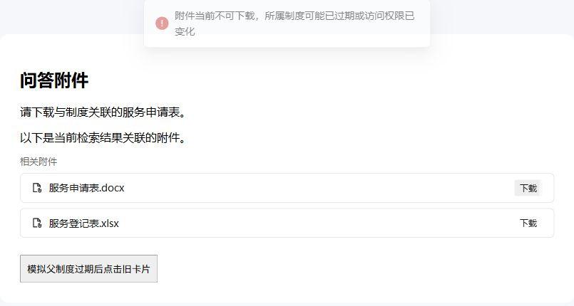

# 附件阶段二／三验收（2026-11-03）

范围：用户明确批准检索关联附件/下载Metadata、父生命周期失败关闭、原生聊天TDesign卡片。基线`5c03ea6`；阶段一全部未提交改动保留。本批不新增依赖、数据库表/迁移或血缘边，未提交/推送、未替换生产Core/Host。

## 实际链路

- 原生batch/list API读取文件Metadata，只有附件自己和同库父文档的已核验生命周期都是active才许可。父stale/archived/其他非active/缺失、元数据/DB故障拒绝。
- RAG最终prompt门卫后、Agent检索/重排后进行可选after_retrieve增强，返回原生文档下载链接。该增强失败清除旧字段但不阻断回答；before_retrieve及附件下载失败关闭。
- 原生实际文档下载路径`/api/v1/knowledge/{id}/download`保留原权限，在打开文件前重新查Host许可。未扩展到`/files`、旧签名资源、已下载字节或生成流中撤销。
- `metadata.related_attachments`为JSON数组字符串，前端兼容数组形态；RAG引用及Agent tool_data.results共同收集、去重、仅允许同项原生URL。TDesign卡片和已登记Markdown链接复用登录Blob下载，不传Host凭据到浏览器。

## 真实Core/Host E2E

命令在WSL自有网络命名空间启用回环后执行：

```bash
CORE_BINARY="$PWD/tmp/WeKnora-lite-attachment-downloads" \
AGENTRAG_ATTACHMENT_REPORT="$PWD/tmp/attachment-downloads-e2e.log" \
python3 extensions/scripts/attachment_e2e.py --governance
```

原生账号/库、Core和worker Host、SQLite、上传/下载/检索与分块都是真实运行组件；正文Office转换、Embedding、生成及Agent工具调用/重排由本地夹具驱动。合成主DOCX有2附录/1表格；不是本批再次实测云端模型、生产Office引擎或用户生产库。父过期只修改隔离测试的日期输入，再重启Host由生产Sweep产生active→stale事件，没有直接修改current状态。

完整最终输出，退出0：

```text
[SCOPE] Real candidate Core + worker Host + private SQLite; local model/Office DocReader fixtures; original sample read-only
[NATIVE-LIST] PASS: one parent + 2 independent DOCX annexes visible through native list API; forced parent metadata verified
[CONTENT] PASS: 1 tables preserved in independent DOCX packages; parent and every child completed native chunking/indexing
[REPLAY] PASS: repeat extraction reconciled same independent IDs; no extra documents; child extraction did not recurse
[RETRIEVAL] PASS: real RAG parent hit, direct attachment hit and Agent search emitted native download metadata
[PARENT-STALE] PASS: actual expiry scan made parent stale; child remained active; links absent and old native download URL returned 403
[HOST-OFFLINE] PASS: previously issued attachment download URL blocked; HTTP 403
[RESULT] Attachment stage-two/three E2E PASS; exit=0; no lineage edges or production services changed
```

实现/夹具问题记录：Host既有测试只模拟列表，新增batch元数据读取后先失败；补齐原生batch协议夹具，不回退生产策略。Agent验收依次暴露缺重排配置、模型夹具kb_id缺失及自有KB target TenantID=0的原生适配；前两项修正夹具，后一项沿用已有governance.go的登录tenant兜底后成功。原生Agent可能在既有合法范围命中主文档和多个附件，断言目标存在且链接不越出本库附件集，没有改变搜索算法。SSE脚本现在消费显式终态/错误，避免错误后继续等心跳。

## 前端实际组件

Computer Use在独立本地Vite验收页加载**实际**`RelatedAttachments.vue`、TDesign及原生登录下载函数。两个合成文件展示为卡片，点击产生浏览器下载；下载字节与测试服务`synthetic attachment`完全相同。随后模拟服务端403，点击旧卡片显示拒绝提示。该页面不是生产App/用户库，完整App部署另验。



预览夹具曾因runtime-only Vue模板及Vite fallback拦截API失败，已改render函数和前置测试middleware，再核对真实下载字节与403提示，未以早期截图/下载作为通过依据。

## 验证命令

| 目录 | 命令 | 本轮结果 |
|---|---|---|
| extensions | `go test -mod=readonly -p 1 ./... -count=1` | 0，完整扩展；在自有netns运行 |
| extensions | `CGO_ENABLED=0 go build -mod=readonly ./...` | 0 |
| extensions | `go vet -mod=readonly ./...` | 0 |
| extensions | `CGO_ENABLED=1 go test -mod=readonly -race ./retrieval ./bridge ./host ./weknora -count=1` | 0，受影响四包 |
| extensions | `python3 scripts/check_module_boundary.py` | 0，294 imports |
| extensions | `python3 -m unittest discover -s scripts -p '*_test.py' -v` | 0，33例、2既有skip |
| extensions | `go list -deps -f '{{.ImportPath}}' ./...` | 0，无WeKnora/internal依赖 |
| extensions | `go env GOMOD GOWORK`、`gofmt -l .` | 正确独立module、workspace空、格式无输出 |
| 根 | `CGO_ENABLED=1 go build -mod=readonly -tags=lite,sqlite_fts5 -ldflags='-X github.com/Tencent/WeKnora/internal/handler.Edition=lite' -o tmp/WeKnora-lite-attachment-downloads ./cmd/server` | 0，CGO候选Core |
| 根 | `CGO_ENABLED=1 go test -mod=readonly -tags=sqlite_fts5 ./internal/extensionbridge ./internal/handler ./internal/application/service/chat_pipeline ./internal/agent/tools -run 'Test(Attachment\|Extension\|Governance\|GuardPrompt\|FilterBridge)' -count=1` | 0，四包定向；表格中反斜线仅为竖线展示转义，实际regex为普通alternation |
| frontend | `npm test` | 0，2379项：2378通过/1既有skip |
| frontend | `npm run type-check` | 0 |
| frontend | `npm run build` | 0，仅既有大chunk提示 |
| 根 | `git diff --check` | 0；两聊天组件新行CRLF问题修正后通过 |

AGENTS.md第7.5条要求的原M2治理回归也已运行：自有netns，`CORE_BINARY=tmp/WeKnora-lite-attachment-downloads python3 extensions/scripts/governance_e2e.py`退出0。覆盖RAG正文/描述正向、Agent search/read/list正向、真实active→stale后同会话/已知ID中正文/描述/旧答案均不进入任何模型请求、断Host的RAG及Agent答案生成0次；原生来源运行收束及FK检查通过。本地夹具不等于真实云模型验收。

一次独立只读复核：Critical0/Important0/Minor1，Minor为上述换行格式必需门禁；保留原始行字节、仅新增行使用LF后通过检查，两聊天文件实际仅新增10/8行，没有整文件格式化，没有二次复核。未运行上游全仓Go/make test、生产负载、真实云模型/Office引擎或完整App生产替换验收。范围与启用见[操作说明](../operations/文档附件提取与入库.md)。
