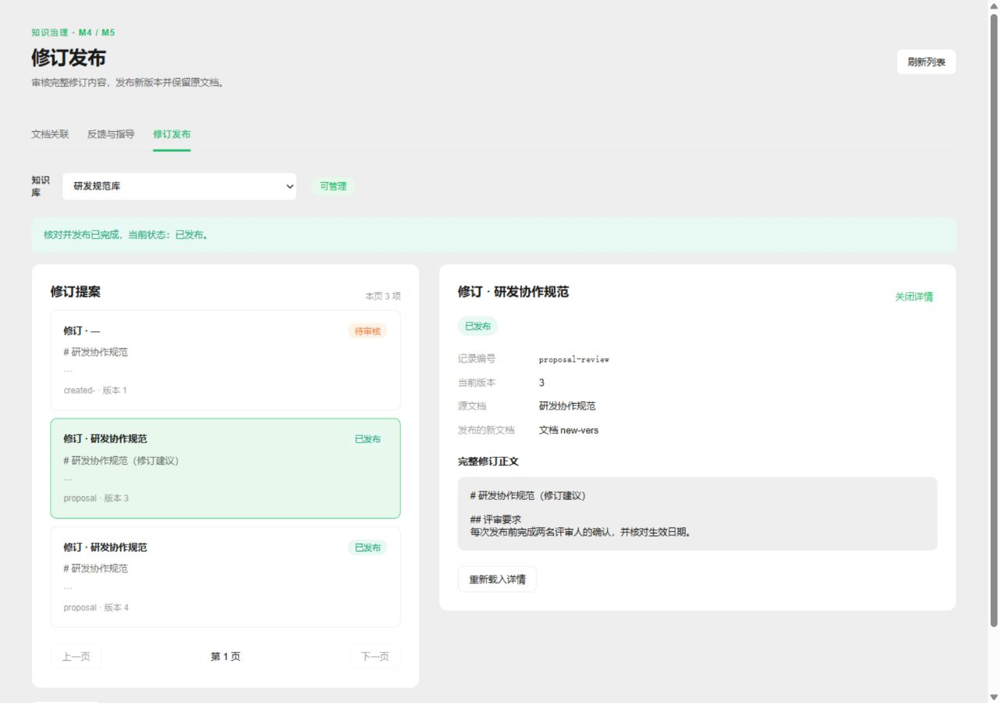
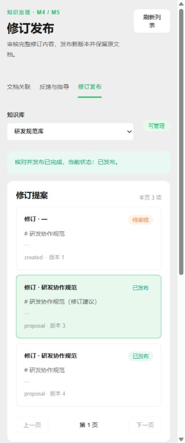

# M4/M5 业务工作台验收

2026-11-02开始，2026-11-03完成本批。源码基于`5f77d7b3d3c3cdb04c08b9edff90fec617555a1a` / `v0.9.0-3-g5f77d7b`；开始时工作区干净。未提交、推送、迁移真实库或替换生产服务。

## 交付范围

- 原生导航三页：文档关联、反馈与指导、修订发布。复用JWT管理API、KB读写权限、主题/状态规则与发布Saga，不向浏览器下发Host凭据。
- 列表和详情按当前KB读取、每页20项；支持关联候选确认/撤销与有效关系查询，反馈/种子录入与审批、冷静期/高风险确认，完整Markdown提案/审批/发布恢复。
- 唯一新增后台读取为`relation_list`。原生仅扩展`internal/handler/extension_lifecycle.go`现有只读动作枚举；业务及SQL留在extensions。无依赖、SQL迁移、原生业务算法或根模块改变。
- 网络未知时保留不可变原操作编号、展示revision与内容；禁止未核对切页，重试使用原请求。异步列表/详情/权限/KB目录响应按scope隔离。

## 本轮检查

以下最终命令均退出0；前端在Windows执行，Go/Python在Ubuntu WSL执行，显式`PATH=/usr/local/go/bin:/usr/bin:/bin`。

| 工作目录 | 命令 | 结果 |
|---|---|---|
| frontend | `npm test` | 2376项：2375通过、1跳过、0失败；日志`tmp/business-ui-tests.log` |
| frontend | `npm run type-check` | 退出0；日志`tmp/business-ui-typecheck.log` |
| frontend | `npm run build` | 退出0，3m15s；日志`tmp/business-ui-build.log`；仍有既有大chunk提示 |
| extensions | `go test -mod=readonly -p 1 ./... -count=1` | 全模块通过；`tmp/sprint-extensions.log` |
| extensions | `go test -mod=readonly -race ./business ./management -count=1` | 受影响业务/管理包race通过 |
| extensions | `go build -mod=readonly ./...`、`go vet -mod=readonly ./...` | 均退出0 |
| extensions | `gofmt -l .` | 无输出 |
| extensions | `go env GOMOD GOWORK` | 正确嵌套module，无workspace |
| extensions | `python3 scripts/check_module_boundary.py` | 293 imports，无WeKnora依赖或workspace |
| extensions | `python3 -m unittest discover -s scripts -p '*_test.py' -v` | 33项，31通过，2按平台/opt-in跳过 |
| 仓库根 | `CGO_ENABLED=1 go test -mod=readonly -tags=sqlite_fts5 ./internal/handler ./internal/extensionbridge ./internal/router -run 'Test(ExtensionLifecycle\|ExtensionBusiness\|Management)' -count=1` | handler/extensionbridge通过；router编译通过但无匹配用例 |
| 仓库根 | `CGO_ENABLED=1 go build -mod=readonly -tags=lite,sqlite_fts5 -o tmp/WeKnora-lite-business-check ./cmd/server` | 候选核心构建通过，不替换生产 |
| 仓库根 | `git diff --check` | 退出0；既有前端文件未改行保留原换行格式 |

首轮前端style guard发现3处新CSS token问题，修正后最终全量通过。Python首次缺少显式Go PATH导致7项门禁测试无法运行；设置上述PATH后33项按表通过，没有修改断言。

## 真实Core/Host API联合验证

真实候选Core、生产实现worker Host、独立临时SQLite、本机模型夹具，在私有网络空间运行，不停现有Host：

```bash
cd /mnt/d/LanRAG-Next
unshare -Urn -- bash <<'E2E'
set -e
ip link set lo up
export PATH=/usr/local/go/bin:/usr/bin:/bin
CORE_BINARY="$PWD/tmp/WeKnora-lite-business-check" \
AGENTRAG_BUSINESS_E2E=1 \
AGENTRAG_GOVERNANCE_REPORT="$PWD/docs/evidence/m4-m5-business-ui-api-2026-11-02.log" \
python3 extensions/scripts/governance_e2e.py
E2E
```

最终退出0。完整脱敏日志见[m4-m5-business-ui-api-2026-11-02.log](m4-m5-business-ui-api-2026-11-02.log)。本次新增断言通过原生JWT GET读取刚声明的`relation_list?id=...`，核对持久ID和目标文档；其余覆盖：

- 反馈审批→未到期409→隔离库推进截止时间→激活指导；不是声称实际等待48h。
- 指导→审批提案→真实原生manual ingest/index→supersedes，重复发布保留同一目标。
- 有效关联查询/撤销、版本及active许可、生命周期过期；当前RAG/Agent正向和stale/断Host负向仍通过，断Host答案生成0次。
- 不声明真实云端模型、生产语料或完整M4/M5指标验收。

## 浏览器交互与响应式验证

通过浏览器实际运行当前Vue组件，使用`browser.fixture.mjs`提供合成业务数据和受控应答；不是将合成页面冒充生产Core浏览器E2E。上述Core/Host API验收独立运行。

1. 关联候选载入详情、确认、查询有效关系；确认状态显示“已确认”，不会冒充文档检索许可。
2. 尚在冷静期不显示激活；高风险激活必须勾选二次确认。捕获到实际请求的`second_confirmation=true`。
3. 真实表单选择源文档、完整Markdown及生效指导，提交后显示新待审核提案；审批确认弹窗生效。
4. 模拟“发布已提交但应答503”：保留待核对请求；刷新可看到published；重试沿用同operation_id和expected_revision，返回同回执。尝试切页被阻止且原请求保留。
5. Viewer可看完整记录，无审批/创建入口；切换KB清空旧详情并读取新KB记录。
6. 1280px宽度两列；375px宽度单列，页面`scrollWidth=clientWidth=360`，无横向溢出。浏览器尺寸已恢复，临时标签和夹具进程已清理。





## 审查修正与边界

一次独立只读复核发现2项Important：未知应答切页丢原请求、写后慢刷新覆盖新scope详情。两项均添加执行实际Vue setup的回归，先观察失败再修正通过，包含于最终全量测试。未为此改变业务规则或放松服务端权限。

未运行全原生测试/全扩展race、make build-lite、真实账号浏览器生产联调或生产部署；本批不能代替这些检查。MCP关联工具、问答反馈采集/指导注入、family标签处理、正式修订文件上传、真实关联标定以及既有T4/T5缺口继续保留在backlog，不标完整M4/M5或M2完成。
